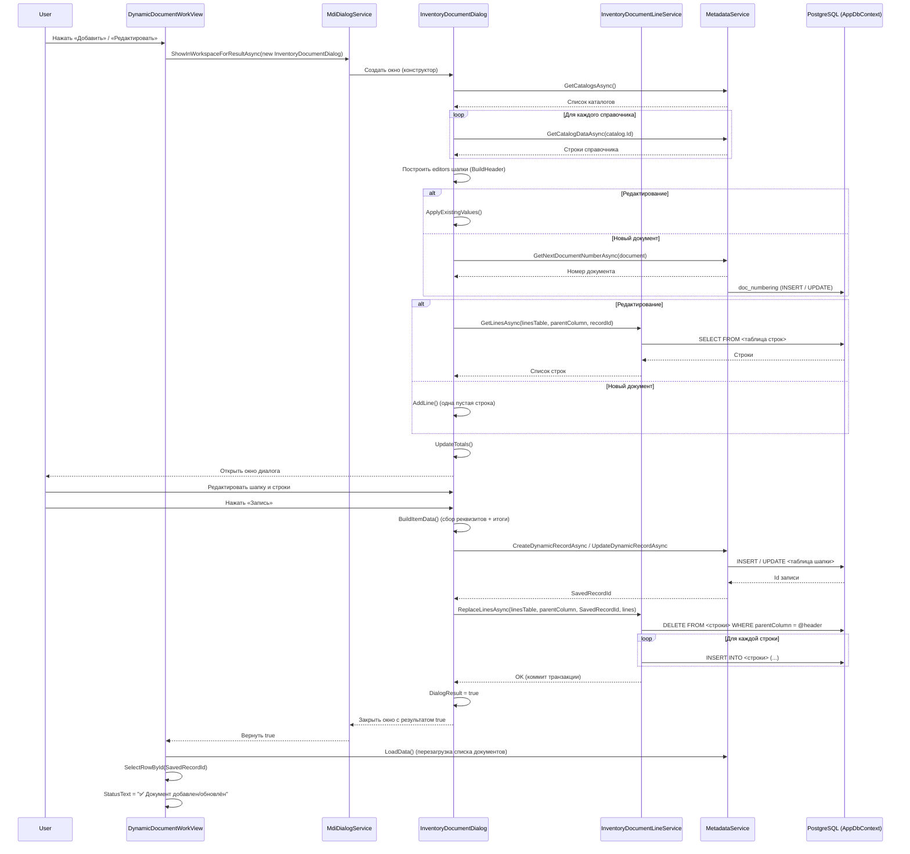

# Документ ТМЗ: диалог `InventoryDocumentDialog`

## Назначение

Окно редактирования документа товарно-материальных запасов (ТМЗ) по образцу счёта-фактуры: **шапка документа** (реквизиты заголовка) + **таблица строк** (материалы, количества, цены, налоги, итоги) + панель итогов.

Диалог используется для трёх видов документов:

| Документ | Имя в метаданных | Таблица шапки | Таблица строк | Иконка |
|---|---|---|---|---|
| Поступление ТМЗ | `Поступление ТМЗ` | `doc_inventory_incoming` | `doc_inventory_incoming_lines` | 📥 |
| Выбытие ТМЗ | `Выбытие ТМЗ` | `doc_inventory_outgoing` | `doc_inventory_outgoing_lines` | 📤 |
| Внутреннее перемещение ТМЗ | `Внутреннее перемещение ТМЗ` | `doc_inventory_movement` | `doc_inventory_movement_lines` | 🔁 |

Размер окна: 1280 × 820, позиционирование `CenterOwner`.

**Пространство имён:** `BIS.ERP.Views.Dialogs`  
**Класс:** `public partial class InventoryDocumentDialog : Window`  
**Файлы:** `Views/Dialogs/InventoryDocumentDialog.xaml`, `Views/Dialogs/InventoryDocumentDialog.xaml.cs`
## Открытие и закрытие

Диалог открывается из `DynamicDocumentWorkView` (панель работы с документами) через `MdiDialogService.ShowInWorkspaceForResultAsync` как MDI-дочернее окно workspace.

### Создание нового документа

```csharp
var dialog = new InventoryDocumentDialog(_documentMetadata, _metadataService, _context);
dialog.Owner = Window.GetWindow(this);
if (await MdiDialogService.ShowInWorkspaceForResultAsync(
        Window.GetWindow(this),
        dialog,
        $"Новый документ: {_documentMetadata.Name}") == true)
{
    await LoadData();
    DataGrid.SelectRowById(dialog.SavedRecordId, DataGridSelectionHelper.GetIdFromDataRow);
    StatusText.Text = "✅ Документ добавлен";
}
```

Параметры конструктора:

| Параметр | Тип | Назначение |
|---|---|---|
| `document` | `MetadataObject` | Метаданные документа (из `MetadataService`) |
| `metadataService` | `MetadataService` | Сервис для работы с динамическими записями и справочниками |
| `context` | `AppDbContext` | Контекст БД (передаётся в `InventoryDocumentLineService`) |
| `recordId` | `Guid?` | Идентификатор существующей записи (для редактирования); `null` — создание |
| `existingData` | `Dictionary<string, object>?` | Данные существующей записи (для редактирования) |

### Редактирование существующего документа

```csharp
var rows = await _metadataService.GetCatalogDataAsync(_documentMetadata.Id);
var existing = rows.FirstOrDefault(row =>
    row.TryGetValue("Id", out var value) && value is Guid guid && guid == id);

var dialog = new InventoryDocumentDialog(_documentMetadata, _metadataService, _context, id, existing);
dialog.Owner = Window.GetWindow(this);
if (await MdiDialogService.ShowInWorkspaceForResultAsync(
        Window.GetWindow(this),
        dialog,
        $"Редактирование: {_documentMetadata.Name}") == true)
{
    await LoadData();
    DataGrid.SelectRowById(id, DataGridSelectionHelper.GetIdFromDataRow);
    StatusText.Text = "✅ Документ обновлён";
}
```

### Результат диалога

- `DialogResult = true` — пользователь нажал «Запись»; документ сохранён. Доступен через свойство `SavedRecordId` (Guid).
- `DialogResult = false` — пользователь нажал «Отмена» или закрыл окно; изменения не сохранены.

Если MDI workspace недоступен, `MdiDialogService` откроет окно обычным модальным `ShowDialog()`.

## Инициализация

Инициализация выполняется асинхронно в обработчике события `Loaded`:

```csharp
Loaded += async (_, _) => await InitializeAsync();
```

### Этапы инициализации

1. **Загрузка справочников** — `MetadataService.GetCatalogsAsync()` возвращает все каталоги.
2. **Наполнение combo-полей шапки** — для каждого справочника загружаются данные через `MetadataService.GetCatalogDataAsync(catalog.Id)` и形成 списки `RefItem` (Id + Display):
   - `План счетов` — поле «Счет» (`counterparty_account`), id как код.
   - `Организации` — поле «Организация» (`organization_id`).
   - `Сотрудники (Списочный состав)` — поле «Сотрудник» (`employee_id`).
   - `Типы поставки` — поле «Вид покупки» (`supply_kind`).
   - `Налоги` — поля «Вид НДС» (`vat_type`) и «Налог» (`sales_tax_type`).
   - `Виды оплаты` — поле «Вид оплаты» (`payment_kind`).
   - `Справочник валют` — поле «Валюта» (`currency_id`).
   - `Участки` — поля «Участок-получатель» (`destination_site_id`) и колонка строк «Участок».
   - `МОЛ` — поля «МОЛ-получатель» (`destination_person_id`) и колонка строк «МОЛ».
   - `Справочник материалов` — источник для колонки «Материал» в строках (кэш `_materialRows`).
   - `Вид операции ТМЗ` (`EntryCatalogName`) — поле «Вид операции» (`document_entry_id`). В списке — только виды операций вида `movement_kind` этого документа: у «Поступления ТМЗ» — `Incoming` (приход), у выбытия — `Outgoing`, у перемещения — `Movement`; кэш `_entryOperationKinds` для получения кода операции.
3. **Построение заголовка** — для каждого поля метаданных создаётся редактор (`TextBox`, `DatePicker`, `ComboBox`) на `HeaderPanel` (WrapPanel).
4. **Применение существующих значений** — для режима редактирования значения полей из `_existing` устанавливаются в соответствующие элементы управления.
5. **Генерация номера документа** — для новой записи, если поле `doc_number` пустое, вызывается `_metadataService.GetNextDocumentNumberAsync(_document)`.
6. **Загрузка строк** — `LoadLinesAsync()`:
   - Для новой записи: добавляется одна пустая строка (`AddLine()`).
   - Для существующей: строки загружаются через `_lineService.GetLinesAsync(linesTable, parentColumn, recordId)`.
7. **Пересчёт итогов** — `UpdateTotals()` вызывается после загрузки строк.

Если на любом этапе возникает исключение, показывается `MessageBox` с текстом ошибки и окно закрывается (`Close()`).

## Обновление справочников

Данные справочника «Вид операции ТМЗ» (`catalog_inventory_document_entries`) загружаются один раз при открытии диалога и кэшируются в `_entryOperationKinds` (соответствие `Id` → `operation_kind`). Список обрезается по документу: `FilterEntriesForDocument()` оставляет записи с `movement_kind` = `Incoming` / `Outgoing` / `Movement` (для старых записей — по `document_name`); уже сохранённый вид операции остаётся в списке, даже если не проходит фильтр. Если reference-данные изменяются в БД пока окно открыто, изменения не отображаются автоматически.

### Кнопка «Обновить справочники»

На панели действий есть кнопка **«Обновить справочники»** (`OnRefreshClick` → `RefreshEntriesAsync()`), которая:

1. Снова загружает все каталоги через `MetadataService.GetCatalogsAsync()`.
2. Перезагружает строки `catalog_inventory_document_entries` через `MetadataService.GetCatalogDataAsync()`.
3. Очищает кэш `_entryOperationKinds` и заполняет его заново из свежих данных.
4. Обновляет `ItemsSource` ComboBox «Вид операции».
5. Сбрасывает выбранное значение в ComboBox.

Ошибки при обновлении отображаются в `MessageBox` с иконкой предупреждения, окно не закрывается.

## Поля шапки документа

Поля создаются динамически на основе метаданных документа (`_document.Fields`). Основные поля:

| Поле | Имя колонки | Тип управления | Справочник | Примечание |
|---|---|---|---|---|
| Номер | `doc_number` | TextBox | — | Генерируется автоматически для новой записи |
| Дата | `doc_date` | DatePicker | — | Глобальная маска `DatePickerInputMaskBehavior`: посимвольный ввод и шаблон `DD/MM/YYYY` + календарь. Значение читается через `SelectedDate`. По умолчанию `DateTime.Today` |
| Вид операции | `document_entry_id` | ComboBox | Вид операции ТМЗ | Только виды операций своего `movement_kind`; код операции сохраняется в `operation_kind` |
| № пачки | `pack_number` | TextBox | — | |
| Серия/№ бланка | `tax_blank_number` | TextBox | — | |
| Номер ЭСФ | `esf_number` | TextBox | — | |
| Счет | `counterparty_account` | ComboBox | План счетов | uuid → План счетов |
| Организация | `organization_id` | ComboBox | Организации | |
| Сотрудник | `employee_id` | ComboBox | Сотрудники | |
| Вид покупки | `supply_kind` | ComboBox | Типы поставки | |
| Вид НДС | `vat_type` | ComboBox | Налоги | |
| Ставка НДС, % | `vat_rate` | TextBox | — | Используется как начальная для строк |
| Вид оплаты | `payment_kind` | ComboBox | Виды оплаты | |
| Налог | `sales_tax_type` | ComboBox | Налоги | |
| Ставка налога, % | `sales_tax_rate` | TextBox | — | Используется как начальная для строк |
| Валюта | `currency_id` | ComboBox | Справочник валют | |
| Курс | `exchange_rate` | TextBox | — | |
| Участок-получатель | `destination_site_id` | ComboBox | Участки | |
| МОЛ-получатель | `destination_person_id` | ComboBox | МОЛ | |
| Примечание | `basis` | TextBox | — | |

Каждый редактор хранится в словаре `_editors` по имени колонки (`DbColumnName`).

### Компоновка карточек

- **Поставщик** — левая колонка шириной треть окна (`1*` против `2*` у налогов). Каждый контрол — отдельная строка: подпись сверху, поле растянуто на всю ширину карточки, кнопка «?» справа. Организация и сотрудник показываются только при привязках счёта.
- **Валюта** — отдельный блок `CurrencyCard` под карточками «Поставщик» и «Налоги и оплата», на всю ширину окна, как в счёте-фактуре: «Валюта» | «Курс» с кнопкой «?» | «Сумма в валюте» (только чтение) | кнопка «Текущий курс». Виден только когда у выбранного счёта включён признак «Связь с валютами» (`UpdateAccountDependencies`).
  - Валюта берётся из самого счёта — реквизит «Валюта счета» (`account_currency_id`) плана счетов: она подставляется в список и блокируется от ручной смены. Если у валютного счёта валюта не заполнена, список остаётся доступным.
  - Курс подтягивается на дату документа из справочника курсов валют (`GetCurrencyRateForDateAsync`); для базовой валюты (KGS) — 1. При загрузке уже сохранённого документа курс из записи не перетирается.
  - «?» открывает `CurrencyRatesDialog` — историю курсов текущей валюты с выбором курса; «Текущий курс» опрашивает новые курсы (`ImportLatestOfficialCurrencyRatesAsync`, XML НБКР) и подставляет последний известный (`GetLatestCurrencyRateAsync`).
  - «Сумма в валюте» — итог документа по курсу шапки; это же значение сохраняется в `amount_currency` (без валютного счёта — итог, как раньше).
- **Налоги и оплата** — правая колонка (две трети ширины): «Вид НДС», «Ставка НДС, %», «Вид оплаты», «Налог», «Ставка налога, %» — тоже по контролу в строке, на всю ширину блока.

## Строки инвентаризации

Строки документа хранятся в отдельной таблице `<шапка>_lines` (например, `doc_inventory_incoming_lines`). Связь с шапкой через колонку-родитель (`incoming_id`, `outgoing_id` или `movement_id`).

### Модель строки: `InventoryLineRow`

Реализует `INotifyPropertyChanged`. Свойства:

| Свойство | Тип | Описание |
|---|---|---|
| `Id` | `Guid` | Идентификатор строки |
| `LineNumber` | `int` | Номер строки (пересчитывается при сохранении) |
| `MaterialId` | `Guid?` | Ссылка на материал (Справочник материалов) |
| `MaterialName` | `string` | Наименование материала |
| `UnitName` | `string` | Единица измерения |
| `AccountCode` | `string` | Код счета дебета строки |
| `SiteId` | `Guid?` | Участок |
| `ResponsiblePersonId` | `Guid?` | МОЛ |
| `Quantity` | `decimal` | Количество |
| `Price` | `decimal` | Цена |
| `AmountWithoutTax` | `decimal` | Сумма без налога (Quantity × Price) |
| `VatRate` | `decimal` | Ставка НДС, % |
| `VatAmount` | `decimal` | Сумма НДС |
| `SalesTaxRate` | `decimal` | Ставка налога с продаж, % |
| `SalesTaxAmount` | `decimal` | Сумма налога с продаж |
| `LineTotal` | `decimal` | Итого строки (AmountWithoutTax + VatAmount + SalesTaxAmount) |
| `AmountCurrency` | `decimal` | Сумма в валюте |
| `Description` | `string` | Примечание |

### Сервис строк: `InventoryDocumentLineService`

Конструктор принимает `AppDbContext` и открывает собственное Npgsql-соединение к БД.

| Метод | Назначение |
|---|---|
| `GetLinesAsync(linesTable, parentColumn, headerId)` | Загрузка строк документа из таблицы строк по идентификатору шапки, упорядоченные по `line_number`. |
| `ReplaceLinesAsync(linesTable, parentColumn, headerId, lines)` | Полная замена строк: внутри транзакции удаляются все старые строки шапки, затем вставляются новые с пересчётом номеров (начиная с 1). |
| `RecalculateTotals(lines, out amountWithoutTax, out vatAmount, out salesTaxAmount, out total)` | Статический метод: пересчитывает итоги по всем строкам документа. |

### Работа со строками в диалоге

- **Добавление строки** — кнопка «Добавить строку» → `AddLine()`. Новая строка получает начальные значения `VatRate` и `SalesTaxRate` из полей шапки.
- **Удаление строки** — кнопка «Удалить строку» удаляет выбранную строку из `_lines` и вызывает `UpdateTotals()`.
- **Пересчёт** — кнопка «Пересчет» вызывает `Recalculate()` для каждой строки, обновляет грид и итоги.
- **Выбор материала** — колонка «Материал» (`DataGridTemplateColumn`) сделана как поле счёта в шапке: текстовое поле `MaterialText` + кнопка «?». Кнопка открывает `ReferenceSelectionDialog` по справочнику материалов (Код, Наименование, Ед. изм.) с поиском; введённый в ячейку текст заранее подставляется в строку поиска (`SetSearchText`). Ручной ввод: при уходе из ячейки текст сопоставляется со справочником (точный код → точное наименование → единственное совпадение по началу кода или части наименования). После выбора заполняются `MaterialId`, `MaterialCode`, `MaterialName`, `UnitName`, затем `Recalculate()` и `UpdateTotals()`.
- **Дебет** — такое же поле ввода + «?»: в ячейке хранится `AccountText` («Код - Наименование»), при вводе/выборе код сверяется с планом счетов и сохраняется в `AccountCode`. «?» открывает тот же диалог выбора счёта, что и в шапке.
- **«?» в ячейках** — клик перехватывается на уровне таблицы (`PreviewMouseLeftButtonDown` с `handledEventsToo`), иначе DataGrid тратит его на выделение строки и кнопка «не работает».
- **Enter** — переход к следующей вводимой колонке; после последней колонки — на следующую строку, а в конце последней строки — создание новой строки с курсором в «Материал» (`AddLine()` + `FocusFirstEntryCell`). При открытии диалога курсор сразу встаёт в первую колонку первой строки.
- **Проверка перед сохранением** — в каждой строке должен быть выбран материал (`MaterialId.HasValue`) и указано количество (> 0). Иначе показывается предупреждение и сохранение прерывается.

### Логика пересчёта строки (`Recalculate()`)

```csharp
AmountWithoutTax = Round(Quantity × Price, 2);
VatAmount = Round(AmountWithoutTax × VatRate / 100, 2);
SalesTaxAmount = Round(AmountWithoutTax × SalesTaxRate / 100, 2);
LineTotal = Round(AmountWithoutTax + VatAmount + SalesTaxAmount, 2);
```

Округление: `MidpointRounding.AwayFromZero`, 2 знака.

## Сохранение документа

Кнопка «Запись» (`OnSaveClick`) выполняет следующую последовательность:

1. **Валидация строк** — каждая строка должна иметь материал (`MaterialId.HasValue`) и количество > 0. Иначе показывается предупреждение и сохранение прерывается.
2. **Построение данных шапки** — `BuildItemData()`:
   - Для каждого поля метаданных считывается значение из соответствующего редактора (`ReadEditorValue`).
   - Пустые текстовые значения пропускаются (`null`).
   - Добавляются итоговые суммы: `amount_without_tax`, `vat_total`, `sales_tax_total`, `amount`, `amount_currency`.
   - Для поля «Вид операции» (`document_entry_id`) из выбранного элемента combo берется код операции через `_entryOperationKinds` и сохраняется в `operation_kind`. Если выбранный элемент не найден в `_entryOperationKinds`, выбрасывается `InvalidOperationException` с сообщением о необходимости указать вид документа ТМЗ.
   - Для новой записи устанавливается `is_posted = false`.
3. **Создание или обновление записи шапки**:
   - Редактирование: `_metadataService.UpdateDynamicRecordAsync(document.Id, recordId, data)`.
   - Создание: `SavedRecordId = await _metadataService.CreateDynamicRecordAsync(document.Id, data)`.
4. **Замена строк** — `_lineService.ReplaceLinesAsync(linesTable, parentColumn, SavedRecordId, _lines.ToList())` внутри транзакции.
5. **Закрытие** — `DialogResult = true`.

Все ошибки сохранения перехватываются и отображаются в `MessageBox` (окно не закрывается).

## Нумерация документа

Номер документа для новой записи получается через:

```csharp
numberBox.Text = await _metadataService.GetNextDocumentNumberAsync(_document);
```

`MetadataService.GetNextDocumentNumberAsync(MetadataObject document)`:

1. Создаёт таблицу нумерации `doc_numbering` (если не существует).
2. Определяет ключ нумерации документа (`GetDocumentNumberingKey(document)`).
3. Сканирует существующие документы этого типа и вычисляет следующий номер (`GetSuggestedNextDocumentNumberAsync`).
4. Вставляет запись в `doc_numbering` (`ON CONFLICT DO NOTHING`).
5. Обновляет счётчик только в сторону увеличения (никогда не уменьшает), чтобы избежать сброса нумерации.


## Обработка ошибок

| Место | Обработка |
|---|---|
| `InitializeAsync()` | Весь метод обёрнут в `try/catch`. При исключении — `MessageBox.Show(ex.Message, ... Error)` и `Close()`. |
| `OnSaveClick()` | Весь метод обёрнут в `try/catch`. При исключении — `MessageBox.Show(ex.Message, ... Error)`. Окно остаётся открытым (`DialogResult` не устанавливается). |
| Валидация строк | `MessageBox` с предупреждением (`MessageBoxImage.Warning`), сохранение прерывается (`return`). |
| `ReplaceLinesAsync()` | Ошибки внутри транзакции пробрасываются в `OnSaveClick` и обрабатываются общим `catch`. |
Номер не пересчитывается при редактировании существующего документа — поле `doc_number` редактируется пользователем вручную.

## Схема взаимодействия



## Классы и типы

### `InventoryDocumentLineService` (`Services/InventoryDocumentLineService.cs`)

- `InventoryDocumentLineService(AppDbContext context)` — конструктор.
- `Task<List<InventoryLineRow>> GetLinesAsync(string linesTable, string parentColumn, Guid headerId)` — загрузка строк.
- `Task ReplaceLinesAsync(string linesTable, string parentColumn, Guid headerId, IReadOnlyList<InventoryLineRow> lines)` — замена строк (DELETE + INSERT в транзакции).
- `static void RecalculateTotals(...)` — статический расчёт итогов.

### `InventoryLineRow` (`Services/InventoryDocumentLineService.cs`)

Модель строки с `INotifyPropertyChanged` и методом `Recalculate()`.

### `InventoryDocumentModel` (`Services/InventoryDocumentModel.cs`)

Статический класс с константами и определениями документов:

- `IncomingName`, `OutgoingName`, `MovementName` — имена документов.
- `IncomingTable`, `OutgoingTable`, `MovementTable` — таблицы шапок.
- `IncomingLinesTable`, `OutgoingLinesTable`, `MovementLinesTable` — таблицы строк.
- `EntryCatalogName = "Вид операции ТМЗ"` — каталог видов операций (`EntryCatalogLegacyName` — прежнее имя для переименования баз).
- `DocumentDefinition` — описание документа (имя, таблица, строки, колонка-родитель, иконка, порядок, описание, legacy-имена).
- `KindDefinition` — описание вида операции (код, название, документ, группа движения, порядок, описание). Всего 8 видов операций.

### `MetadataService` (`Services/MetadataService.cs`)

Ключевые методы, используемые диалогом:

| Метод | Назначение |
|---|---|
| `GetCatalogsAsync()` | Список всех каталогов метаданных. |
| `GetCatalogDataAsync(Guid catalogId)` | Данные каталога (строки). |
| `GetNextDocumentNumberAsync(MetadataObject document)` | Следующий номер документа. |
| `CreateDynamicRecordAsync(Guid metadataId, Dictionary<string, object> data)` | Создание динамической записи (документа). |
| `UpdateDynamicRecordAsync(Guid metadataId, Guid recordId, Dictionary<string, object> data)` | Обновление существующей динамической записи. |

### `MdiDialogService` (`Services/MdiDialogService.cs`)

| Метод | Назначение |
|---|---|
| `ShowInWorkspaceForResultAsync(Window owner, Window dialog, string? title, ...)` | Открыть диалог как MDI-документ с возвратом результата (`Task<bool?>`). При недоступности workspace — модальное `ShowDialog()`. |

## Проверка и notas

- Файл документации создан без изменения исходного кода проекта.
- Сборка проекта: `dotnet build .\BIS.ERP.sln`.
- Диалог работает с PostgreSQL через Npgsql (страницы строк — прямые SQL-запросы через `AppDbContext`).
- Поле `counterparty_account` (Счет шапки) — ссылка на справочник «План счетов», хранится как uuid.
- Вид операции из поля `document_entry_id` сохраняется отдельно в `operation_kind` (код из `_entryOperationKinds`).
- Номер документа генерируется только для новых записей и только если поле пустое.
- Поле `doc_date` (Дата шапки) реализовано как `DatePicker` (метод `AddDateText`); оно использует глобальную маску `DatePickerInputMaskBehavior` (инициализируется в `App.xaml.cs` на `DatePicker.Loaded`) — посимвольный ввод, шаблон `DD/MM/YYYY` и календарь. Значение засевается через `SetDateEditor` (`SelectedDate`), применяется в `ApplyExistingValues`, читается при сохранении в `ReadEditorValue` (`case DatePicker`).