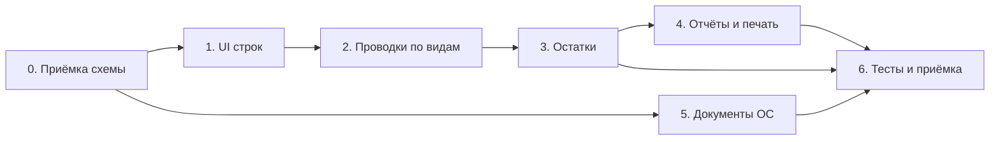

# ТМЗ и ОС в BIS.ERP: отчёт о выполненных работах и план

**Дата:** 20.10.2026
**Автор:** анализ кода, метаданных и двух живых инфобаз (`bis_OsOO1_20260908_112439`, `bis_OsOO2_20261019_130122`)
**Статус:** отчёт — по факту изменений в рабочей папке; план — предлагаемый порядок работ

---

# Часть I. Отчёт

## 1.1 Исходная точка (состояние на утро 20.10.2026)

| Область | Что было |
|---|---|
| Документы ТМЦ | 7 документов: «Приход товаров», «Расход товаров» + 5 таблиц-клонов `doc_inventory_<hash>`, различавшихся только названием |
| Модель ТМЦ | один материал в шапке (`material_id`, `quantity`, `price`); строк нет |
| Документы ОС | 17 имён в коде, в актуальной базе — 0 объектов: удалены 17.10.2026 вместе с хеш-таблицами |
| Имена таблиц | `doc_incoming` / `doc_outgoing` вне префикса модуля, 22 хеш-таблицы в старой базе |
| Применение миграций | EF-миграции выполняются только при создании базы; на существующих не запускаются |
| Журнал `schema_migrations` | `applied_at` перезаписывался при каждом прогоне повторяемых шагов |
| UI ТМЦ | универсальный `CatalogDataView` / `DynamicDocumentWorkView`, без строк документа |

## 1.2 Что сделано — пять итераций

| № | Итерация | Результат |
|---|---|---|
| 1 | Анализ модулей ОС и ТМЦ | `Docs/ТМЦ_и_ОС_структура_и_связи.md`: 10 справочников ОС, 39 полей карточки, 17 документов, отчёты, UI, связи, дефекты |
| 2 | Канон имён таблиц | `Services/DocumentTableNames.cs` (реестр), `DocumentTableNameNormalizer`, EF-миграция `20261020101500`, SQL-скрипт `Docs/normalize_doc_table_names.sql` |
| 3 | Разбор «миграция не сработала» | Найдены две причины: `Migrate` не вызывается при открытии базы; параметры `@p0` внутри `DO $$…$$` не подставляются (ошибка 42703). DDL переписан через `format('%I')`, добавлен шаг `2026.10.20.01` |
| 4 | Журнал миграций | `applied_at` замораживается, добавлен `last_run_at`, `runs`; `clock_timestamp()` вместо `now()`; шаг нормализации стал разовым |
| 5 | Модель документов ТМЗ | 3 документа + 3 таблицы строк + справочник видов операций; 4 документа-признака удаляются |

## 1.3 Код: что изменено и где

### Новые файлы

| Файл | Назначение | Объём |
|---|---|---|
| `Services/DocumentTableNames.cs` | Реестр «имя документа → таблица», константы ОС и ТМЗ, проверки хеш-имён | ~250 строк |
| `Services/DocumentTableNameNormalizer.cs` | Переименование legacy-таблиц и PK по реестру, идемпотентно | ~290 строк |
| `Services/InventoryDocumentModel.cs` | Модель ТМЗ: 3 документа, 8 видов операций, наборы полей шапки и справочника | ~330 строк |
| `Services/InventoryDocumentSchemaService.cs` | Приведение базы и метаданных к модели ТМЗ | ~600 строк |
| `Migrations/20261020101500_NormalizeDocumentTableNames.cs` | EF-миграция нормализации имён (для баз, проходящих `Migrate`) | ~200 строк |

### Изменённые файлы

| Файл | Что изменено |
|---|---|
| `Services/SchemaMigrationService.cs` | Шаги `2026.10.20.01` (имена) и `2026.10.21.01` (модель ТМЗ); журнал: `last_run_at`, заморозка `applied_at` |
| `Services/DocumentationMetadataSeedService.cs` | Вызовы нормализатора и `InventoryDocumentSchemaService` в `EnsureAsync` |
| `Services/MetadataService.cs` | Создание документов ТМЗ под новыми именами; отключена достройка «материал в шапке» |
| `Services/MetadataService.Catalogs.cs` | Шаблоны отчётов ссылаются на «Поступление ТМЗ» / «Выбытие ТМЗ» |
| `Services/ModuleMetadataService.cs` | Список документов ТМЗ — из реестра `DocumentTableNames` (3 имени вместо 7) |
| `Services/BalanceService.cs` | Журнал закупок/продаж: новые имена + прежние подстроки как fallback |
| `Services/FixedAssetMovementLineService.cs`, `Models/FixedAssetMovementLine.cs` | Таблица строк ОС → `doc_asset_movement_lines` |

## 1.4 Целевая схема ТМЗ

### Шапки и строки

| Документ | Шапка | Строки | Родитель |
|---|---|---|---|
| Поступление ТМЗ | `doc_inventory_incoming` | `doc_inventory_incoming_lines` | `incoming_id` |
| Выбытие ТМЗ | `doc_inventory_outgoing` | `doc_inventory_outgoing_lines` | `outgoing_id` |
| Внутреннее перемещение ТМЗ | `doc_inventory_movement` | `doc_inventory_movement_lines` | `movement_id` |

Строки — 17 колонок: `line_number`, `material_id`, `material_name`, `unit_name`, `account_code` (Дебет), `site_id` (Участок), `responsible_person_id` (МОЛ), `quantity(18,3)`, `price(18,6)`, `amount_without_tax`, `vat_rate(8,2)`, `vat_amount`, `sales_tax_rate`, `sales_tax_amount`, `line_total`, `amount_currency`, `description`. FK на шапку — `ON DELETE CASCADE`, индексы по родителю и `(родитель, line_number)`.

### Шапка — 32 поля, одинаковых у всех трёх (состав сверен с окном счёта-фактуры и эталоном)

`doc_number`, `doc_date`, `document_entry_id` (вид операции), `operation_kind`, `pack_number`, `tax_blank_number`, `esf_number`, `counterparty_account` (Счет), `organization_id`, `employee_id`, `supply_kind` (Вид покупки), `vat_type`, `vat_rate`, `payment_kind`, `sales_tax_type`, `sales_tax_rate`, `currency_id`, `exchange_rate`, `amount_without_tax`, `vat_total`, `sales_tax_total`, `transport_amount`, `customs_amount`, `other_expenses_amount`, `amount`, `amount_currency`, `basis`, `destination_site_id`, `destination_person_id`, `debit_account`, `credit_account`, `is_posted`.

Строки (17 колонок): `line_number`, `material_id`, `material_name`, `unit_name`, `account_code` (Дебет), `site_id`, `responsible_person_id`, `quantity`, `price`, `amount_without_tax`, `vat_rate`, `vat_amount`, `sales_tax_rate`, `sales_tax_amount`, `line_total`, `amount_currency`, `description`.

### Справочник видов операций

`catalog_inventory_document_entries` (7 полей), 8 строк:

| Код | Наименование | Документ |
|---|---|---|
| `INCOMING_PURCHASE` | Приобретение ТМЗ | Поступление ТМЗ |
| `INCOMING_PRODUCTION` | Приход из производства | Поступление ТМЗ |
| `INCOMING_ACT` | Приход по акту | Поступление ТМЗ |
| `OUTGOING_SALE` | Реализация ТМЗ | Выбытие ТМЗ |
| `OUTGOING_PRODUCTION` | Расход в производство | Выбытие ТМЗ |
| `OUTGOING_WRITEOFF` | Списание по акту | Выбытие ТМЗ |
| `MOVEMENT_ASSIGNMENT` | Передача в подотчет | Внутреннее перемещение ТМЗ |
| `MOVEMENT_AUTO` | Автоматическая передача | Внутреннее перемещение ТМЗ |

### Что удаляется и переименовывается

| Объект | Действие |
|---|---|
| «Приход товаров» → «Поступление ТМЗ» | переименование документа и таблицы `doc_incoming` → `doc_inventory_incoming` |
| «Расход товаров» → «Выбытие ТМЗ» | `doc_outgoing` → `doc_inventory_outgoing` |
| «Внутреннее перемещение ТМЦ» → «Внутреннее перемещение ТМЗ» | `doc_inventory_<hash>` → `doc_inventory_movement` |
| «Приход из производства ТМЦ», «Расход в производство», «Передача ТМЦ в подотчет», «Инвентаризация ТМЦ» | удаляются: метаданные, поля, правила проводок, привязки к модулю, пустая таблица |
| `number`, `date` в шапках | переименованы в `doc_number`, `doc_date` |
| `material_id`, `quantity`, `price`, `vat_rate` в шапках | удаляются, если шапка пустая; иначе остаются с предупреждением |

## 1.5 Как изменения попадают в базу

| Механизм | Когда срабатывает | Журнал |
|---|---|---|
| `SchemaMigrationService`, шаг `2026.10.20.01` | при открытии существующей базы, разово | `schema_migrations` |
| `SchemaMigrationService`, шаг `2026.10.21.01` | при открытии существующей базы, разово | `schema_migrations` |
| `DocumentationMetadataSeedService.EnsureAsync` | при каждом входе и в конфигураторе | — (идемпотентно, обычно no-op) |
| EF-миграция `20261020101500` | только при `Database.MigrateAsync()` — создание новой базы | `__EFMigrationsHistory` |
| `Docs/normalize_doc_table_names.sql` | вручную, для копий и архивов | — |

Семантика журнала: `applied_at` — первый успешный прогон (не меняется), `last_run_at` — последний прогон, `runs` — сколько раз выполнялся.

## 1.6 Выполненные проверки

1. **DDL-прогон на живой базе ОсОО1 в транзакции с откатом.** Проверены: переименование трёх шапок, переименование `number`/`date`, добавление новых колонок, создание трёх таблиц строк с FK и индексами, удаление четырёх пустых таблиц, создание справочника и вставка 8 видов. Все шаги прошли; `ROLLBACK` вернул `doc_incoming`.
2. **Семантика журнала.** Два прогона одного шага в одной транзакции: `applied_at` не изменился, `last_run_at` сдвинулся, `runs` = 2.
3. **Проверка ссылок.** В отчётах, наборах данных и печатных формах нет SQL со старыми именами `doc_incoming` / `doc_outgoing` — переименование безопасно.
4. **Статический контроль.** Проверен баланс скобок во всех изменённых файлах (компилятора в системе нет).

## 1.7 Фактическое состояние баз (на момент отчёта)

| Показатель | ОсОО1 | ОсОО2 |
|---|---|---|
| Таблицы шапок ТМЦ | `doc_incoming`, `doc_outgoing` (старые) | `doc_incoming`, `doc_outgoing` (старые) |
| Новые таблицы ТМЗ | нет | нет |
| `schema_migrations` | до `2026.10.19.07` | таблицы нет |
| Документы ТМЦ в метаданных | 7 (2 + 5 хеш) | 2 |
| Применение новой модели | **не выполнялось** | **не выполнялось** |

То есть код готов, но ни одна база ещё не проходила шаги `2026.10.20.01` и `2026.10.21.01`: приложение с новой сборкой не запускалось.

## 1.8 Ограничения отчёта

* **Сборка не выполнялась** — в системе нет .NET SDK 8.0.425 (`global.json`), только runtime. Проверены структура и баланс скобок, не типы.
* **Тесты не прогонялись** — smoke-сценарии требуют сборки и базы.
* **Не сделано:** UI строк, проводки по видам операций, остатки ТМЗ, отчёты по остаткам, печатные формы.

## 1.9 Ключевые решения и альтернативы

| Решение | Альтернатива | Почему так |
|---|---|---|
| 3 документа + вид операции | 7 документов на каждый признак | пять таблиц были идентичны по составу и различались только названием; вид — реквизит, а не сущность |
| Строки `_lines` | один материал в шапке | документ должен содержать несколько материалов; шапка хранит итоги — как в финансах |
| Справочник видов операций | перечисление в коде | пользователь добавляет вид без пересборки; состав повторяет эталонный диалог |
| Реестр имён в коде | имена в разметке и строках | один источник истины, нормализация и проверки в одном месте |
| Переименования — разовыми шагами | держать их повторяемыми | переименование меняет схему; повторяемость допустима только для аддитивных шагов |
| Удалять таблицы только пустыми | удалять всегда | исключает потерю данных; при наличии строк — предупреждение в лог |
| EF-миграция **и** шаг `SchemaMigrationService` | только EF | EF не выполняется при открытии существующей базы; шаг закрывает этот случай |

---

# Часть II. План

## 2.1 Цель

Довести модуль ТМЗ до рабочего состояния «документ → строки → проводки → остатки → отчёты», затем вернуть работоспособность документам ОС. Критерий финала: закрытие месяца даёт корректные остатки ТМЗ и амортизацию ОС, отчёты сходятся с проводками.

## 2.2 Принципы

1. Метаданные — единственный источник структуры; DDL — только через миграции.
2. Один документ на бизнес-смысл, вид операции — реквизит (не таблица).
3. Строки документа — отдельная таблица `_lines`, как в финансах.
4. Каждый шаг миграции — идемпотентный и с проверкой условия применимости.
5. Удаление данных — только при пустой таблице; иначе предупреждение в лог.

## 2.3 Этапы

| Этап | Название | Цель | Оценка |
|---|---|---|---|
| 0 | Приёмка схемы ТМЗ | Убедиться, что шаги применились и ничего не сломалось | 0,5 дня |
| 1 | UI строк документа | Ввод многострочного документа ТМЗ | 3–4 дня |
| 2 | Проводки по видам операций | Каждый вид формирует свои проводки | 2–3 дня |
| 3 | Остатки ТМЗ | Снимки остатков по периодам, контроль | 3–4 дня |
| 4 | Отчёты и печатные формы | Ведомости, журналы, М-4/М-17/МХ-1 | 2–3 дня |
| 5 | Документы ОС | Вернуть 17 документов, включить автоамортизацию | 2–3 дня |
| 6 | Тесты и приёмка | Smoke-сценарии, проверка на копии | 2 дня |
| 7 | Развитие | Склады, партии, ФИФО, инвентаризация | после решения по §4 |

Итого до рабочего модуля ТМЗ (этапы 0–4 и 6): **13–17 рабочих дней**; вместе с возвратом документов ОС — **15–20**.

## 2.4 Задачи

### Этап 0. Приёмка схемы ТМЗ

| ID | Задача | Зависит | Готово когда |
|---|---|---|---|
| T0.1 | Резервная копия ОсОО1 и ОсОО2 перед применением | — | дампы сняты, размер и дата зафиксированы |
| T0.2 | Собрать решение и запустить на копии ОсОО1 | — | сборка без ошибок, приложение открывает базу |
| T0.3 | Проверить шаги `2026.10.20.01` и `2026.10.21.01` | T0.2 | в `schema_migrations` обе записи, `runs = 1` |
| T0.4 | Проверить схему: 3 шапки, 3 таблицы строк, 3 FK, справочник 8 строк | T0.3 | SQL из §3.2 даёт ожидаемый результат |
| T0.5 | Проверить удаление: 4 документа нет, таблиц нет, привязок нет | T0.3 | запросы возвращают 0 строк |
| T0.6 | Проверить навигацию и открытие трёх документов | T0.3 | документы видны в модуле «Материалы», карточка открывается |
| T0.7 | Проверить, что старые проводки и отчёты не сломались | T0.3 | журнал проводок и «Ведомость наличия материалов» открываются |

**Риск этапа:** шаг удаляет таблицы. Мера — T0.1 и правило «удалять только пустые».

### Этап 1. UI строк документа

| ID | Задача | Зависит | Готово когда |
|---|---|---|---|
| T1.1 | `InventoryDocumentLineService`: `EnsureSchemaAsync`, `GetLinesAsync`, `ReplaceLinesAsync`, `RecalculateTotals` | — | строки читаются/пишутся, итоги считаются по формуле строки |
| T1.2 | Окно документа по образцу `InvoiceEditDialog`: шапка + `LinesGrid` (материал, ед., дебет, участок, МОЛ, %, кол-во, цена, без НДС, НДС, итого) + блок итогов | T1.1 | добавление/удаление/правка строк без потери данных |
| T1.3 | Выбор материала через `ReferencePickerControlFactory`, подстановка единицы и цены | T1.2 | выбор материала заполняет `material_name`, `unit_name`, `price` |
| T1.4 | Пересчёт шапки по строкам (`amount`, `vat_total`, `sales_tax_total`) | T1.1 | итог шапки = сумма `line_total` |
| T1.5 | Валидация: материал и количество обязательны; проведённый документ не редактируется | T1.2 | попытка сохранить пустую строку даёт понятную ошибку |
| T1.6 | Сохранение/загрузка строк вместе с шапкой (транзакция) | T1.1–T1.5 | после переоткрытия строки на месте |

**Готово когда:** документ «Поступление ТМЗ» с тремя строками сохраняется, переоткрывается, итоги совпадают с ручным расчётом.

### Этап 2. Проводки по видам операций

| ID | Задача | Зависит | Готово когда |
|---|---|---|---|
| T2.1 | Автозаполнение `operation_kind` из справочника при выборе вида | T0.4 | смена вида меняет код в шапке |
| T2.2 | Матрица проводок на 8 видов (счёт склада, затрат, расчётов, дохода) | T2.1 | матрица согласована и зафиксирована в документе |
| T2.3 | Генерация проводок при проведении: по строкам или итогом | T2.2 | приход: Дт склад / Кт расчёты; расход в производство: Дт затраты / Кт склад |
| T2.4 | Распроведение: удаление проводок, возврат `is_posted` | T2.3 | повторное проведение не дублирует проводки |
| T2.5 | Контроль счетов: обязательность, связь счёта с материалами | T2.3 | документ без счетов не проводится, текст ошибки понятен |

**Готово когда:** по каждому из 8 видов создаётся документ и проводки соответствуют матрице; распроведение возвращает состояние.

### Этап 3. Остатки ТМЗ

| ID | Задача | Зависит | Готово когда |
|---|---|---|---|
| T3.1 | Таблица `InventoryPeriodBalances` (период, материал, склад/МОЛ, остатки на начало/приход/расход/конец в количестве и сумме) | T2.3 | таблица создаётся миграцией, индексы на месте |
| T3.2 | Расчёт остатков при сборе периода (`CollectAsync`) | T3.1 | после закрытия месяца остаток = приход − расход |
| T3.3 | ReportSource «Снимки остатков ТМЗ» | T3.1 | отчёт видит источник и поля |
| T3.4 | Контроль отрицательных остатков | T3.2 | расход больше остатка даёт предупреждение/запрет (по решению §4) |

**Готово когда:** два месяца подряд: остаток на конец первого = остаток на начало второго.

### Этап 4. Отчёты и печатные формы

| ID | Задача | Зависит | Готово когда |
|---|---|---|---|
| T4.1 | Ведомость остатков ТМЗ (по складам/МОЛ) | T3.2 | сумма по ведомости = сумма остатков |
| T4.2 | Обороты по материалам за период | T3.2 | приход/расход/конечный остаток сходятся с документами |
| T4.3 | Журнал документов по видам операций | T2.1 | фильтр по виду операции работает |
| T4.4 | Печатные формы: М-4, требование-накладная М-11, МХ-1 | T1.6 | формы открываются из карточки, суммы совпадают |

### Этап 5. Документы ОС

| ID | Задача | Зависит | Готово когда |
|---|---|---|---|
| T5.1 | Создать 17 документов ОС по реестру `DocumentTableNames` с полями `FixedAssetDocumentFields` | — | 17 объектов и таблиц, привязка к модулю |
| T5.2 | Убрать имена ОС из `DevelopmentHiddenNavigationObjectNames` | T5.1 | документы видны в дереве — **сделано 20.10.2026: список удалён полностью** |
| T5.3 | Проверить автоамортизацию при закрытии месяца | T5.1 | создаётся «Начисление амортизации» с номером `DEP-yyyyMM-…` |
| T5.4 | Проверить проводки ОС и отчёты `assets.*.journal` | T5.1 | журналы начисления/реализации наполняются |

**Готово когда:** закрытие месяца начисляет амортизацию и формирует снимки остатков ОС.

### Этап 6. Тесты и приёмка

| ID | Задача | Зависит | Готово когда |
|---|---|---|---|
| T6.1 | Smoke-сценарий ТМЗ: приход 3 строки → выбытие 2 строки → закрытие → остатки | T3.2 | сценарий зелёный на копии боевой |
| T6.2 | Smoke-сценарий ОС (существующий `FixedAssetsSmokeScenario`) | T5.1 | сценарий проходит |
| T6.3 | Проверка миграции на копиях ОсОО1 и ОсОО2 | T0.3 | обе базы приведены, ошибок в логе нет |
| T6.4 | Обновление документации (этот файл + `Docs/ТМЗ_модель_документов.md`) | — | документы соответствуют коду |

## 2.5 Граф зависимостей



Этап 5 (ОС) не зависит от ТМЗ и может идти параллельно этапам 1–4.

## 2.6 Риски и меры

| Риск | Вероятность | Влияние | Мера |
|---|---|---|---|
| Шаг удаляет таблицы с данными | низкая | высокое | удаление только пустых; дамп перед применением (T0.1) |
| Ошибка компиляции в новом коде (сборка не проверялась) | средняя | высокое | T0.2 — сборка до применения на боевой; при ошибках правим точечно |
| Шаг выполнился частично (сбой посреди переименований) | низкая | среднее | сервис идемпотентен, повторный запуск продолжит; метаданные фиксируются после каждого переименования |
| Строки и шапка рассинхронизируются при сохранении | средняя | среднее | сохранение в одной транзакции (T1.6) |
| Проводки по видам разойдутся с учётной политикой | средняя | высокое | матрица проводок согласуется до реализации (T2.2) |
| Отрицательные остатки | средняя | среднее | решение §4, затем контроль в T3.4 |
| Дубли отчётов ТМЗ/старых шаблонов | низкая | низкое | ревизия отчётов в T4.1–T4.3 |

## 2.7 Что не входит в план

* Переход на партионный учёт и ФИФО — только после решения §4.
* Валютный учёт ТМЗ.
* Переделка карточки ОС и справочников ОС (косметика).
* Автоматический перенос данных из FoxPro.

## 2.8 Первые шаги (на завтра)

1. Снять дампы обеих баз и записать пути (T0.1).
2. Собрать решение, запустить на копии ОсОО1, пройти чек-лист §3.1 (T0.2–T0.6).
3. Если чек-лист зелёный — начинать T1.1 (`InventoryDocumentLineService`), параллельно согласовать вопросы 1–3 из §4 (склад, оценка, партии), потому что от них зависит структура остатков.

---

# Часть III. Приёмка

## 3.1 Чек-лист этапа 0 (сегодня)

- [ ] Дампы ОсОО1 и ОсОО2 сняты, путь и дата записаны.
- [ ] Сборка без ошибок.
- [ ] В `schema_migrations` есть `2026.10.20.01` и `2026.10.21.01`, `runs = 1`.
- [ ] В логе нет строк `не выполнена` по этим шагам.
- [ ] Три документа ТМЗ открываются, поля шапки на месте.
- [ ] Четыре удалённых документа отсутствуют в навигации и в `MetadataObjects`.
- [ ] `catalog_inventory_document_entries` содержит 8 строк.
- [ ] Старые отчёты и журнал проводок открываются без ошибок.

## 3.2 SQL-проверки

```sql
-- 1. Шаги применились
SELECT version, applied_at, last_run_at, runs
FROM schema_migrations
WHERE version IN ('2026.10.20.01','2026.10.21.01')
ORDER BY version;

-- 2. Три документа и их таблицы
SELECT "Name", "TableName" FROM "MetadataObjects"
WHERE "ObjectType" = 'Document' AND "TableName" LIKE 'doc_inventory_%'
ORDER BY "Name";

-- 3. Строки и внешние ключи
SELECT tc.table_name, kcu.column_name, ccu.table_name AS references
FROM information_schema.table_constraints tc
JOIN information_schema.key_column_usage kcu ON kcu.constraint_name = tc.constraint_name
JOIN information_schema.constraint_column_usage ccu ON ccu.constraint_name = tc.constraint_name
WHERE tc.constraint_type = 'FOREIGN KEY' AND tc.table_name LIKE 'doc_inventory_%_lines'
ORDER BY 1;

-- 4. Виды операций
SELECT "code", "name", "document_name", "movement_kind", "sort_order"
FROM catalog_inventory_document_entries ORDER BY "sort_order";

-- 5. Удалённые документы-признаки (ожидаем 0)
SELECT "Name" FROM "MetadataObjects"
WHERE "ObjectType" = 'Document'
  AND "Name" IN ('Приход из производства ТМЦ','Расход в производство',
                 'Передача ТМЦ в подотчет','Инвентаризация ТМЦ');

-- 6. Осиротевшие таблицы старой модели (ожидаем 0)
SELECT table_name FROM information_schema.tables
WHERE table_schema = 'public' AND table_name LIKE 'doc_inventory\_%'
  AND table_name NOT IN ('doc_inventory_incoming','doc_inventory_outgoing','doc_inventory_movement',
                         'doc_inventory_incoming_lines','doc_inventory_outgoing_lines','doc_inventory_movement_lines');
```

## 3.3 Критерий готовности модуля ТМЗ

1. Документ вводится с произвольным числом строк, итоги считаются автоматически.
2. Проведение формирует проводки по виду операции; распроведение их снимает.
3. Закрытие месяца даёт остатки, равные приходу минус расход, в количестве и сумме.
4. Ведомость остатков и обороты сходятся с остатками и проводками.
5. Повторный вход в базу не делает DDL и не меняет журнал (кроме `last_run_at` повторяемых шагов).

---

# Часть IV. Открытые вопросы (нужно решение до этапов 3–4)

| № | Вопрос | Варианты | Что блокирует |
|---|---|---|---|
| 1 | Склад — это `Участки` или отдельный справочник `Склады`? | существующий «Участок» / новый справочник | T3.1, T4.1 |
| 2 | Оценка при выбытии | средняя / ФИФО / по цене последнего прихода | T2.2, T3.2 |
| 3 | Партионный учёт | нужен / не нужен | T3.1 |
| 4 | Инвентаризация | вид операции / отдельный документ с ведомостью | T2.2, T4.4 |
| 5 | Передача в подотчёт влияет на остатки по МОЛ? | да / нет | T3.1 |
| 6 | Печатные формы | М-4 / М-11 / МХ-1 / свой список | T4.4 |
| 7 | Автоматическая передача | что её инициирует | T2.2 |
| 8 | НДС в ТМЗ | в стоимости / отдельным счётом | T2.2 |
| 9 | ОС: 17 документов или тоже свернуть в «Учет движения ОС» + виды операций, как ТМЗ? | 17 / 1 + виды | этап 5 |

---

# Часть V. Приложение: файлы и документы

## Код

| Файл | Роль |
|---|---|
| `Services/DocumentTableNames.cs` | реестр имён таблиц документов ОС и ТМЗ |
| `Services/DocumentTableNameNormalizer.cs` | переименование legacy-таблиц |
| `Services/InventoryDocumentModel.cs` | модель ТМЗ: документы, виды, поля |
| `Services/InventoryDocumentSchemaService.cs` | приведение базы и метаданных к модели ТМЗ |
| `Services/SchemaMigrationService.cs` | шаги миграций и журнал |
| `Services/DocumentationMetadataSeedService.cs` | сидинг и вызовы миграции модели |
| `Migrations/20261020101500_NormalizeDocumentTableNames.cs` | EF-миграция имён (только для `Migrate`) |

## Документы

| Файл | Содержание |
|---|---|
| `Docs/ТМЦ_и_ОС_структура_и_связи.md` | анализ модулей ОС и ТМЦ до переделки |
| `Docs/Имена_таблиц_документов_ОС_ТМЦ.md` | канон имён, механизмы, проверки |
| `Docs/ТМЗ_модель_документов.md` | целевая модель ТМЗ, поля, виды операций |
| `Docs/Механизм_миграций_схемы.md` | устройство `schema_migrations`, правила шагов |
| `Docs/normalize_doc_table_names.sql` | ручной скрипт нормализации имён |
| этот файл | отчёт и план |

> Технические детали по каждой таблице и полю — в `Docs/ТМЗ_модель_документов.md`; правила добавления шагов миграции — в `Docs/Механизм_миграций_схемы.md`.
