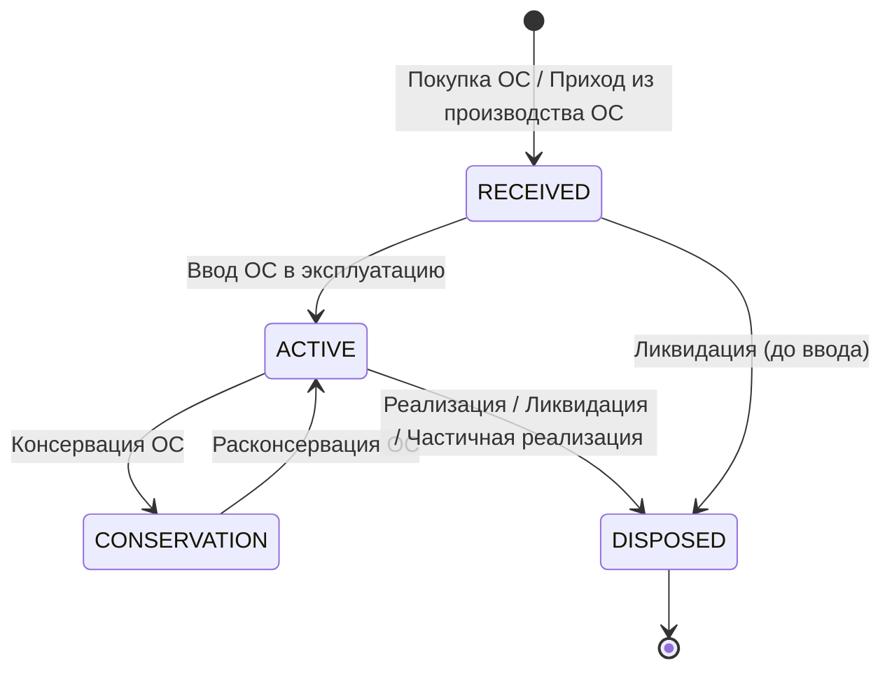
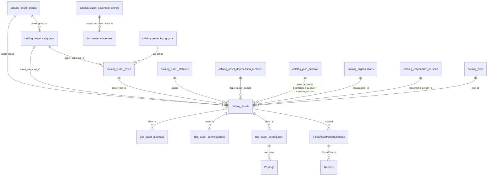
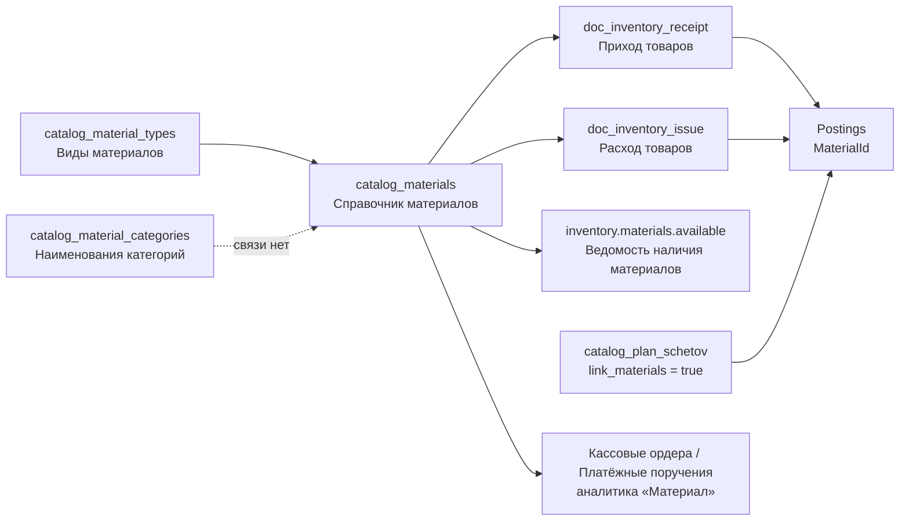

# ТМЦ и ОС в BIS.ERP — структура модулей, метаданных, таблиц, окон и связей

**Дата анализа:** 20.10.2026
**Предмет:** модули `FixedAssets` («Основные средства») и `Inventory` («Материалы» / УМЦ / ТМЦ)
**Метод:** чтение кода (`Services`, `Models`, `Views`, `Data`), плюс прямая сверка с двумя живыми инфобазами PostgreSQL на `localhost:5432`:

| Инфобаза | База данных | Состояние | Таблиц | Объектов метаданных | Отчётов | Полей метаданных |
|---|---|---|---|---|---|---|
| ОсОО1 | `bis_OsOO1_20260908_112439` | «до нормализации» (08.09.2026) | 147 | 79 | 45 | — |
| ОсОО2 | `bis_OsOO2_20261019_130122` | «после нормализации» (19.10.2026) | 95 | 51 | 35 | 628 |

> В `bis_master.InfoBases` запись «ОсОО2» указывает на удалённую базу `bis_OsOO2_20260910_123635` (host `26.84.185.141`); локально лежит её копия `bis_OsOO2_20261019_130122`. Все числа «текущего состояния» ниже — по локальной копии от 19.10.2026.

---

## 0. Краткое резюме (что есть на самом деле)

1. **Оба модуля — метаданные, а не статичные таблицы.** Справочники и документы ОС/ТМЦ живут в `MetadataObjects`/`MetadataFields` и в физических таблицах `catalog_*` / `doc_*`. Статичные EF-сущности `FixedAsset` и `Material` (таблицы `FixedAssets`, `Materials`) — legacy, по 0 строк, в коде нигде не читаются.
2. **ОС — самый проработанный модуль после финансов.** 10 справочников, карточка ОС на 39 полей, 17 документов движения, автоматическое начисление амортизации при закрытии месяца, снимки остатков на 48 колонок и 13 отчётов.
3. **ТМЦ — каркас.** 3 справочника (9 / 4 / 4 поля) и фактически 2 документа (`Приход товаров`, `Расход товаров`), причём в актуальной базе у них всего по 4 поля и **нет правил проводок**. Ещё 5 документов ТМЦ (`Внутреннее перемещение ТМЦ`, `Расход в производство`, `Передача ТМЦ в подотчет`, `Инвентаризация ТМЦ`, `Приход из производства ТМЦ`) существуют только в виде имён в коде и в старой базе.
4. **Документы ОС в актуальной базе отсутствуют.** 17 документов `doc_asset_*` были удалены 17.10.2026 (вместе со всеми хеш-таблицами), сид выключен. При этом обработчики проведения 15 из 17 документов в `MetadataService` сохранены и работоспособны — не хватает только объектов метаданных и таблиц.
5. **Точка входа в ОС для пользователя — не документ, а справочник.** `CatalogDataView` для `catalog_assets` включает фильтр «на дату» (по дате приобретения), подкрашивает выбывшие ОС серым и открывает специализированную карточку `FixedAssetDetailsDialog` (3 вкладки).
6. **Часть ОС-объектов — «мёртвый груз»:** `Соответствия счетов ОС`, `Параметры контура ОС`, `Группы/Подгруппы/Виды ОС`, `Налоговые группы ОС` заводятся и заполняются, но бизнес-логикой не читаются; `FixedAssetMovementLineService` (табличная часть «Учёта движения ОС») не вызывается ни из одного окна.
7. **Есть дефекты модели:** колонка `useful_life_months` фактически хранит **годы**; `Счет хранения` материала — строка, а не ссылка на план счетов; отчёт «Инвентарная передача ОС» в актуальной базе ссылается на несуществующий документ (`DataSourceId = NULL`).

---

## 1. Архитектурная рамка: как из метаданных получается модуль

### 1.1 Три уровня описания

```
MetadataObjects (объект: Catalog | Document | ReportSource)
        │  1:N
MetadataFields (поле: имя, колонка, тип, ссылка, обязательность)
        │  генерирует DDL
Физическая таблица catalog_* / doc_*   ←→   CatalogDataView / DynamicDocumentWorkView
        │
MetadataCalculations (авторасчёт полей)   MetadataPostingRules (проводки)
```

Ключевой код:

| Что | Файл |
|---|---|
| Модель метаданных (`MetadataObject`, `MetadataField`, `MetadataCalculation`, `MetadataPostingRule`) | `Models/Metadata.cs` |
| Создание/изменение объектов, полей, динамических таблиц, проведение документов | `Services/MetadataService*.cs` |
| Создание таблиц по метаданным | `MetadataService.CreateDynamicTableAsync`, `CreateTableForCatalogAsync` |
| Сиды справочников/документов/отчётов ОС и ТМЦ | `Services/DocumentationMetadataSeedService.cs`, `Services/MetadataService.Catalogs.cs`, `Services/MetadataService.Fields.cs` |
| Типы SQL по `FieldType` | `MetadataService.Fields.cs::GetSqlType`, `DocumentationMetadataSeedService.GetSqlType` |

### 1.2 Модули и навигация

Модуль — это запись в `MetadataModules` (`Code`, `Name`, `Icon`, `Order`, `CloseOrder`, `IsActive`, `ParticipatesInPeriodClose`, `RequirePreviousModulesClosed`), а привязка объектов — в `MetadataModuleItems` (`ModuleId`, `ObjectId`, `ObjectType`, `Order`).

Определение системных модулей — `Services/ModuleMetadataService.cs:85-112`:

| Код | Имя | Иконка | Order | CloseOrder | Активен по умолчанию | В закрытии периода |
|---|---|---|---|---|---|---|
| `Finance` | Финансы | 💰 | 10 | 900 | да | да |
| `Balance` | Баланс | 📊 | 20 | 10000 | нет | нет (итоговый этап) |
| **`FixedAssets`** | **Основные средства** | 🏗 | **30** | **200** | **нет** | **да** |
| **`Inventory`** | **Материалы** | 📦 | **40** | **300** | **нет** | **да** |
| `Payroll` | Зарплата | 👥 | 50 | 400 | нет | да |
| `Sales` | Сбыт | 🚚 | 60 | 500 | нет | да |
| `RawMaterials` | Сырьё | 🌾 | 70 | 600 | нет | да |
| `CostAccounting` | Себестоимость | 🧮 | 80 | 800 | нет | да |

Алиасы имён (для импорта FoxPro и для поля «Закрывает модуль» в плане счетов) — `Services/MetadataService.Catalogs.cs:2395-2399`:

* `6` / `Inventory` / `Учет материальных ценностей` / `УМЦ` / `ТМЦ` / `Материалы` → **Inventory**
* `7` / `FixedAssets` / `Основные средства` / `ОС` → **FixedAssets**

Навигация рабочего окна (`Views/MainWorkWindow.xaml.cs:518-700`) строится так:

```
СПРАВОЧНИКИ                     ← все справочники, включая catalog_assets и catalog_materials
ОСНОВНЫЕ СРЕДСТВА (модуль)
   ├── Справочники   (10 объектов из MetadataModuleItems)
   ├── Документы     (в коде 17 имён; в актуальной базе объектов нет; 16 скрыты списком — §2.4.1)
   └── Отчеты        (13 отчётов)
МАТЕРИАЛЫ (модуль)
   ├── Справочники   (3)
   ├── Документы     (2 видимых)
   └── Отчеты        (1)
СЛУЖЕБНЫЕ ДАННЫЕ
```

Важная деталь: справочники **не** привязываются через конфигуратор модулей (`ModuleManagementView` умеет только документы и отчёты, `Views/Configurator/ModuleManagementView.xaml.cs:63-72`). Привязка справочников к ОС/ТМЦ выполняется кодом по именам:

* `ModuleMetadataService.FixedAssetCatalogNames` (`ModuleMetadataService.cs:443-448`)
* `ModuleMetadataService.InventoryCatalogNames` (`ModuleMetadataService.cs:450-454`)
* `ModuleMetadataService.FixedAssetDocumentNames` (`ModuleMetadataService.cs:464-471`)
* имена документов ТМЦ — `ModuleMetadataService.cs:303-305`

### 1.3 Проводки

Проводка — запись в `Postings` (`Models/Posting.cs`): `DocumentId`, `DocumentType`, `DocumentNumber`, `Date`, `DebitAccount`, `CreditAccount`, `Amount`, `AmountCurrency`, `Currency`, `OrganizationId`, `EmployeeId`, **`MaterialId`**, `Note`.

Проведение документа выполняется одним из трёх путей (`MetadataService.PostDocumentAsync`, диспетчеризация — `MetadataService.cs:2820-2905`):

1. **Специальный обработчик** — для кассовых ордеров, платёжного поручения, авансов, курсовой разницы и **16 документов ОС**.
2. **По правилам проводок** (`MetadataPostingRules`, выражения `{debit_account}`, `{credit_account}`, `{amount}`) — для `Приход товаров`, `Расход товаров` и остальных «простых» документов.
3. **Без проводок** — если правил нет.

Распроведение (`UnpostDocumentAsync`, `MetadataService.cs:2929-2980`) поддерживается только для кассовых, платёжных поручений и документов ОС: для ОС сначала вызывается `ReverseFixedAssetDocumentAsync`, затем удаляются проводки и снимается `is_posted`.

### 1.4 Отчёты

Отчёт — запись в `Reports` (`Models/Report.cs`): `Name`, `Code`, `DataSourceType` (`Catalog` / `Document` / `ReportSource`), `DataSourceId`, `ReportType`, `Fields` (коллекция `ReportField`), `Filters`, `Groups`, `Parameters`, `ClosedXmlLayout`, `PageOrientation`, `ShowInAccountingReports`.

Отчёты ОС/ТМЦ бывают двух поколений:

* **`standard.fixed-assets.*`** — «стандартные» отчёты, объявлены декларативно в `Services/MetadataService.Reports.cs:700-880`.
* **`assets.*` / `inventory.*`** — отчёты, создаваемые сидом `DocumentationMetadataSeedService.EnsureFixedAssetReportsAsync` (`:547-615`) и `EnsureInventoryReportsAsync` (`:709-716`).

Для источника `FixedAssetPeriodBalances` работает автоподстановка периода (`Services/ReportService.cs:346-395`): если пользователь не задал `PeriodId`/`PeriodEnd`, берётся **последний** снимок остатков; если снимков нет — условие `1 = 0` (пустой отчёт вместо ошибки).

### 1.5 Закрытие периода

`AccountingPeriodService.CollectAsync` (`:77-118`) — «сбор информации»:
1. `EnsureFixedAssetPeriodClosingAsync` — автоначисление амортизации по всем активным ОС за каждый закрываемый месяц;
2. `SaveFixedAssetPeriodBalancesAsync` — снимок остатков ОС в `FixedAssetPeriodBalances`;
3. ОСВ по счетам → `AccountTurnoverSnapshots`;
4. остатки по организациям, налоговый журнал, сброс состояний модулей, статус `Collected`.

`CloseAsync` (`:121-141`) требует, чтобы все участвующие модули были закрыты, и проверяет равенство дебета и кредита. `CloseModuleAsync` (`:201-265`) уважает `CloseOrder`: ОС (200) закрывается раньше материалов (300).

---

## 2. Модуль «Основные средства» (FixedAssets)

### 2.1 Паспорт

| Параметр | Значение |
|---|---|
| Код модуля | `FixedAssets` |
| Отображаемое имя | Основные средства |
| Иконка | 🏗 |
| Порядок / порядок закрытия | 30 / 200 |
| Участвует в закрытии периода | да |
| Требует закрытия предыдущих модулей | нет |
| Состояние в базе ОсОО2 | включён (`IsActive = true`) |
| Основная таблица | `catalog_assets` (39 полей) |
| Специальное окно | `Views/Dialogs/FixedAssetDetailsDialog.xaml` + `CatalogDataView` в режиме ОС |
| Отчётов в модуле | 13 |
| Документов в метаданных кода | 17 (в актуальной базе — 0) |

### 2.2 Карта объектов модуля

| Объект метаданных | Тип | Таблица | Полей | Строк (ОсОО2) | Назначение | Реально используется логикой |
|---|---|---|---|---|---|---|
| Основные средства | Catalog | `catalog_assets` | 39 | 0 | Карточка ОС | **да** (UI, амортизация, отчёты, проводки) |
| Соответствия счетов ОС | Catalog | `catalog_asset_account_links` | 5 | 0 | Счёт учёта → счёт амортизации/затрат | нет |
| Группы ОС | Catalog | `catalog_asset_groups` | 6 | 0 | Группа + счета + срок | частично (как значение ссылки) |
| Подгруппы ОС | Catalog | `catalog_asset_subgroups` | 5 | 0 | Подгруппа → группа | частично |
| Виды ОС | Catalog | `catalog_asset_types` | 5 | 0 | Вид → подгруппа, налоговая группа | частично |
| Методы амортизации ОС | Catalog | `catalog_asset_depreciation_methods` | 6 | 2 | `LINEAR`, `RATE` | справочно (метод в карточке) |
| Статусы ОС | Catalog | `catalog_asset_statuses` | 6 | 4 | `RECEIVED`, `ACTIVE`, `CONSERVATION`, `DISPOSED` | **да** (жизненный цикл) |
| Налоговые группы ОС | Catalog | `catalog_asset_tax_groups` | 4 | 2 | `GENERAL`, `EXEMPT` | нет |
| Параметры контура ОС | Catalog | `catalog_asset_module_settings` | 8 | 3 | Fox-параметры `FORM_PR`, `PRIZ_RASHET`, `SCH_NALP` | нет |
| Ввод нового документа ОС | Catalog | `catalog_asset_document_entries` | 7 | 15 | Меню «какой документ ОС вводим» | **да** (диалог ввода документа) |
| Снимки остатков ОС | ReportSource | `FixedAssetPeriodBalances` | 43 | 0 | Источник отчётов по закрытым периодам | **да** |
| Документы ОС (17) | Document | `doc_asset_*` | 13…35 | — | Движение ОС | обработчики есть, объектов нет |

### 2.3 Справочники ОС — поля

#### 2.3.1 «Основные средства» (`catalog_assets`) — 39 полей

Создаётся в `MetadataService.Catalogs.cs:729-756` (`GetFixedAssetFields`), расширяется в `DocumentationMetadataSeedService.ExtendFixedAssetCardAsync` (`:286-317`) и приводится к канону в `EnsureFixedAssetCanonicalModelAsync` (`:319-395`).

| № | Поле | Колонка | Тип | Признаки |
|---|---|---|---|---|
| 1 | Код | `code` | String(50) | обязательное, уникальное |
| 2 | Инвентарный номер | `inventory_number` | String(50) | обязательное, уникальное |
| 3 | Наименование | `name` | String(300) | обязательное |
| 4 | Год выпуска оборудования | `manufacture_year` | Int | |
| 5 | Основной код для инв. № | `use_code_as_inventory_number` | Bool | |
| 6 | Группа ОС | `asset_group` | Reference → Группы ОС | `{Код} - {Наименование}` |
| 7 | Подгруппа ОС | `asset_subgroup_id` | Reference → Подгруппы ОС | |
| 8 | Вид ОС | `asset_type_id` | Reference → Виды ОС | |
| 9 | Дата приобретения | `acquisition_date` | DateTime | |
| 10 | Документ поступления ОС | `acquisition_document_number` | String(100) | |
| 11 | Дата ввода в эксплуатацию | `commissioning_date` | DateTime | |
| 12 | Документ ввода в эксплуатацию | `commissioning_document_number` | String(100) | |
| 13 | Дата начала амортизации | `depreciation_start_date` | DateTime | |
| 14 | Первоначальная стоимость | `initial_cost` | Decimal(18,2) | |
| 15 | Ликвидационная стоимость | `salvage_value` | Decimal(18,2) | |
| 16 | Накопленная амортизация | `accumulated_depreciation` | Decimal(18,2) | |
| 17 | Остаточная стоимость | `carrying_amount` | Decimal(18,2) | |
| 18 | Срок полезного использования | `useful_life_months` | Int | **фактически годы** (см. §7) |
| 19 | Метод амортизации | `depreciation_method` | Reference → Методы амортизации ОС | |
| 20 | Шифр | `depreciation_code` | String(100) | |
| 21 | Норма амортизации, % | `depreciation_rate` | Decimal(18,2) | |
| 22 | Месячная амортизация | `monthly_depreciation` | Decimal(18,2) | авторасчёт |
| 23 | Амортизация по пробегу | `use_mileage_depreciation` | Bool | |
| 24 | Месячный пробег | `monthly_mileage` | Decimal(18,2) | |
| 25 | Ресурс пробега | `mileage_resource` | Decimal(18,2) | |
| 26 | Счет учета | `asset_account` | Reference → План счетов | |
| 27 | Счет амортизации | `depreciation_account` | Reference → План счетов | |
| 28 | Затратный счет | `expense_account` | Reference → План счетов | |
| 29 | Налоговая группа | `tax_group` | Reference → Налоговые группы ОС | |
| 30 | Организация | `organization_id` | Reference → Организации | |
| 31 | МОЛ | `responsible_person_id` | Reference → МОЛ | |
| 32 | Участок | `site_id` | Reference → Участки | |
| 33 | Класс ОС | `asset_class` | Int | `2` = передвижное (пробег) |
| 34 | Статус | `status` | Reference → Статусы ОС | |
| 35 | Активен | `is_active` | Bool | обязательное |
| 36 | Дата консервации | `conservation_date` | DateTime | |
| 37 | Дата расконсервации | `reopening_date` | DateTime | |
| 38 | Дата выбытия | `disposal_date` | DateTime | |
| 39 | Описание | `description` | String(500) | |

Авторасчёт: в `MetadataCalculations` зарегистрировано правило **«Авторасчет месячной амортизации»** (`TargetField = monthly_depreciation`, `CalculationType = Depreciation`), создаётся в `EnsureFixedAssetAutoCalculationsAsync` (`DocumentationMetadataSeedService.cs:1354-1373`) и применяется в `MetadataService.ExecuteAutoCalculationsAsync` после проведения документа.

Три учётных счёта (`asset_account`, `depreciation_account`, `expense_account`) — то, без чего ОС не может амортизироваться и попадать в проводки; их отсутствие ловится контролем в `BalanceService.GetFixedAssetIntegrityWarningsAsync` (`Services/BalanceService.cs:438-500`).

#### 2.3.2 «Группы ОС» (`catalog_asset_groups`) — 6 полей

`Код`, `Наименование`, `Материальный счет` (`asset_account`, String), `Счет амортизации` (`depreciation_account`, String), **`Срок использования, лет`** → колонка `useful_life_months` (Int), `Активен`.

#### 2.3.3 «Подгруппы ОС» (`catalog_asset_subgroups`) — 5 полей

`Код`, `Наименование`, `Группа ОС` (`asset_group_id` → Группы ОС, обязательное), `Срок использования, лет` → `useful_life_months`, `Активен`.

#### 2.3.4 «Виды ОС» (`catalog_asset_types`) — 5 полей

`Код`, `Наименование`, `Подгруппа ОС` (`asset_subgroup_id` → Подгруппы ОС), `Налоговая группа` (`tax_group` → Налоговые группы ОС), `Активен`.

Иерархия классификации: **Группа → Подгруппа → Вид**. Заполняется пользователем, значения выбираются в карточке ОС; на проводки и амортизацию не влияет.

#### 2.3.5 «Методы амортизации ОС» (`catalog_asset_depreciation_methods`) — 6 полей

`Код`, `Наименование`, `Тип расчета` (`calculation_type`), `По умолчанию`, `Активен`, `Описание`.

Предзаполнено (`DocumentationMetadataSeedService.cs:175-192`):

| Код | Наименование | Тип расчета | По умолчанию | Смысл |
|---|---|---|---|---|
| `LINEAR` | Линейный | `Depreciation` | да | сумма = (стоимость − ликвидационная) / (срок × 12) |
| `RATE` | По норме амортизации | `Depreciation` | нет | сумма = (стоимость − ликвидационная) × норма% / 12 |

Фактически алгоритм (`AccountingPeriodService.CalculateFixedAssetMonthlyDepreciation`, `:988-1017`) сначала смотрит **пробег**, потом **срок**, потом **норму** — поле «Метод» на расчёт не влияет.

#### 2.3.6 «Статусы ОС» (`catalog_asset_statuses`) — 6 полей

`Код`, `Наименование`, `Этап` (`lifecycle_stage`, Int), `По умолчанию`, `Активен`, `Описание`.

| Код | Наименование | Этап | Смысл |
|---|---|---|---|
| `RECEIVED` | Поступило | 10 | Есть карточка, нет ввода в эксплуатацию |
| `ACTIVE` | В эксплуатации | 20 | Амортизируется |
| `CONSERVATION` | На консервации | 30 | Амортизация приостановлена |
| `DISPOSED` | Выбыло | 40 | Реализовано / ликвидировано |

#### 2.3.7 «Налоговые группы ОС» (`catalog_asset_tax_groups`) — 4 поля

`Код`, `Наименование`, `Активен`, `Описание`. Заполнено: `GENERAL` (Общая группа), `EXEMPT` (Необлагаемая группа). Используется только как реквизит карточки.

#### 2.3.8 «Параметры контура ОС» (`catalog_asset_module_settings`) — 8 полей

`Код`, `Наименование`, `Строковое значение`, `Счет` (Reference → План счетов), `Булево значение`, `Источник Fox`, `Описание`, `Активен`.

Заполнено (перенос параметров FoxPro `f_osn`):

| Код | Наименование | Значение | Источник Fox |
|---|---|---|---|
| `FORM_PR` | Форма печатного отчета | `prd1n` | `f_osn.FORM_PR` |
| `PRIZ_RASHET` | Признак расчета | false | `f_osn.PRIZ_RASHET` |
| `SCH_NALP` | Счет налогового платежа | — | `sp_nal.SCH_NALP / F_OSN3` |

Ни один параметр пока не читается кодом — это «заготовка совместимости».

#### 2.3.9 «Ввод нового документа ОС» (`catalog_asset_document_entries`) — 7 полей

`Код`, `Наименование`, `Вид движения` (`movement_kind`), `Документ ОС` (`target_document_name`), `Порядок`, `Описание`, `Активен`.

15 записей (`DocumentationMetadataSeedService.SeedFixedAssetDocumentEntryDataAsync`, `:265-284`):

| № | Код (Наименование) | Вид движения | Целевой документ |
|---|---|---|---|
| 1 | Покупка ОС | Приобретение ОС | Покупка ОС |
| 2 | Корректировка стоимости/срока ОС | Корректировка стоимости/срока ОС | Переоценка ОС |
| 3 | Реализация ОС | Выбытие ОС | Реализация ОС |
| 4 | Ликвидация ОС | Выбытие ОС | Ликвидация ОС |
| 5 | Частичная реализация ОС | Выбытие ОС | Частичная реализация ОС |
| 6 | Укомплектация | Приход/расход ОС | Укомплектация ОС |
| 7 | Разукомплектация | Приход/расход ОС | Разукомплектация ОС |
| 8 | Автоматическое начисление износа | Начисление износа | Начисление амортизации |
| 9 | Начисление износа | Доначисление износа | Начисление амортизации |
| 10 | Списание износа | Списание износа | Списание амортизации |
| 11 | Ввод в эксплуатацию | Изменение состояния ОС | Ввод ОС в эксплуатацию |
| 12 | Консервация | Изменение состояния ОС | Консервация ОС |
| 13 | Передача под отчет | Изменение состояния ОС | Передача ОС в подотчет |
| 14 | Смена затратного счета | Смена затратного счета | Смена затратного счета |
| 15 | Смена группы | Смена группы ОС | Смена группы ОС |

Этот справочник — единственный «живой» мост между UI и документами ОС: `DynamicDocumentWorkView.SelectFixedAssetMovementTypeAsync` (`Views/DynamicDocumentWorkView.xaml.cs:377-435`) показывает его модальным списком при добавлении строки в журнал «Учет движения ОС».

#### 2.3.10 «Соответствия счетов ОС» (`catalog_asset_account_links`) — 5 полей

`Код`, `Материальный счет`, `Счет амортизации`, `Затратный счет`, `Активен`. Задумывался как таблица автоподстановки трёх счетов по счёту учёта, но **нигде не читается** — в карточке ОС счета выбираются вручную.

### 2.4 Документы ОС

#### 2.4.1 Состав

`ModuleMetadataService.FixedAssetDocumentNames` (`ModuleMetadataService.cs:464-471`) — 17 имён. В базе ОсОО1 (до нормализации) им соответствовали 17 таблиц `doc_asset_<hash>`; в ОсОО2 их нет.

| Документ | Таблица в ОсОО1 | Полей | Обработчик проведения | Что делает с карточкой ОС |
|---|---|---|---|---|
| Учет движения ОС | `doc_asset_6b6f7755bcd4` | 35 | нет (журнал) | — |
| Покупка ОС | `doc_asset_4ad9b2659b85` | 29 | `ProcessFixedAssetPurchaseDocumentAsync` | ставит `RECEIVED`, пишет `acquisition_date`, стоимость, счета, группу |
| Ввод ОС в эксплуатацию | `doc_asset_1532e88745a3` | 25 | `ProcessFixedAssetCommissioningDocumentAsync` | ставит `ACTIVE`, пишет `commissioning_date` |
| Приход из производства ОС | `doc_asset_bda8509d7c68` | 28 | `ProcessFixedAssetPurchaseDocumentAsync` | то же, что покупка |
| Переоценка ОС | `doc_asset_f4d39d170c45` | 15 | `ProcessFixedAssetValueChangeDocumentAsync` | меняет стоимость и амортизацию, отдельные проводки переоценки |
| Укомплектация ОС | `doc_asset_5c0749c25341` | 15 | `ProcessFixedAssetValueChangeDocumentAsync` (+amount) | увеличивает стоимость и остаточную |
| Разукомплектация ОС | `doc_asset_ded34ae52612` | 15 | `ProcessFixedAssetValueChangeDocumentAsync` (−amount) | уменьшает стоимость и остаточную |
| Реализация ОС | `doc_asset_a9c408de2fad` | 20 | `ProcessFixedAssetDisposalDocumentAsync(full: true)` | списывает, ставит `DISPOSED`, `disposal_date` |
| Частичная реализация ОС | `doc_asset_2714d7e383c5` | 20 | `ProcessFixedAssetDisposalDocumentAsync(full: false)` | частичное списание |
| Ликвидация ОС | `doc_asset_4b82bca92f6c` | 20 | `ProcessFixedAssetDisposalDocumentAsync(full: true)` | списание |
| Начисление амортизации | `doc_asset_c910fe7d4345` | 16 | `ProcessFixedAssetDepreciationDocumentAsync` | ++`accumulated_depreciation`, −−`carrying_amount` |
| Списание амортизации | `doc_asset_9f282226136a` | 14 | `ProcessFixedAssetDepreciationWriteOffDocumentAsync` | −−`accumulated_depreciation`, пересчёт остаточной |
| Консервация ОС | `doc_asset_7683aba91e9f` | 13 | `ProcessFixedAssetStateDocumentAsync("CONSERVATION")` | ставит `CONSERVATION`, `conservation_date` |
| Расконсервация ОС | `doc_asset_7f03c7562f0e` | 13 | `ProcessFixedAssetStateDocumentAsync("ACTIVE")` | ставит `ACTIVE`, `reopening_date` |
| Передача ОС в подотчет | `doc_asset_802b5c195f3a` | 15 | `ProcessFixedAssetAssignmentDocumentAsync` | меняет `organization_id`, `responsible_person_id`, `site_id` |
| Смена затратного счета | `doc_asset_a1340809dc1b` | 13 | `ProcessFixedAssetExpenseAccountChangeDocumentAsync` | пишет `expense_account` |
| Смена группы ОС | `doc_asset_870e1324996c` | 15 | **нет** | — (документ-заглушка) |

Диспетчеризация — `MetadataService.cs:2820-2905`; реализация обработчиков — `MetadataService.cs:3066-3835`; откат — `ReverseFixedAssetDocumentAsync` (`:3066-3185`).

#### 2.4.2 Общая шапка документов ОС

`StandardDocumentFields()` (`DocumentationMetadataSeedService.cs:1113-1126`) + поле ОС:

`Номер` (`doc_number`), `Дата` (`doc_date`), **`Основное средство`** (`asset_id` → Основные средства, обязательное), `Организация`, `МОЛ`, `Участок`, `Сумма`, `Счет дебета`, `Счет кредита`, `Основание`, `Примечание`, `Проведен`.

Специфические поля по типам (`FixedAssetDocumentFields`, `:878-968`):

* **Покупка / Приход из производства**: `acquisition_date`, `supplier_name` (только покупка), `asset_group_id`, `asset_subgroup_id`, `asset_type_id`, `depreciation_method`, `useful_life_months`, `depreciation_rate`, `depreciation_account`, `expense_account`, `tax_group` + блок износа (`salvage_value`, `depreciation_start_date`, `use_mileage_depreciation`, `monthly_mileage`, `mileage_resource`, `asset_class`).
* **Ввод в эксплуатацию**: `commissioning_date`, метод, срок, норма, счёт амортизации (обязательный), затратный счёт (обязательный), налоговая группа + блок износа.
* **Начисление амортизации**: `depreciation_amount`, `depreciation_account`, `expense_account`, `end_date`.
* **Списание амортизации**: `depreciation_amount` (обязательное), `end_date`.
* **Переоценка**: `cost_adjustment_amount`, `depreciation_adjustment_amount`, `revaluation_account`.
* **Смена затратного счета**: `new_expense_account` (обязательное).
* **Реализация / Частичная реализация / Ликвидация**: `disposal_date`, `proceeds_amount`, `settlement_account`, `disposal_income_account`, `disposal_expense_account`, `disposal_cost_amount`, `disposal_depreciation_amount`, `disposal_carrying_amount`.
* **Консервация / Расконсервация**: `end_date`.

#### 2.4.3 «Учет движения ОС» — 35 полей и табличная часть

Единственный документ с «многопозиционной» задумкой. Поля (`FixedAssetMovementDocumentFields`, `:970-1012`):

`doc_number`, `doc_date`, **`asset_document_entry_id`** (→ Ввод нового документа ОС, обязательное), `invoice_number`, `tax_blank_number`, `settlement_account`, `organization_id`, `purchase_kind_id` (→ Типы поставки), `vat_type_id` (→ Налоги), `payment_type_id` (→ Виды оплаты), `sales_tax_type_id` (→ Налоги), `currency_id`, `exchange_rate`, `asset_id`, `acquisition_date`, `commissioning_date`, `depreciation_start_date`, `site_id`, `responsible_person_id`, `useful_life_months`, `depreciation_account`, `expense_account`, `operation_account`, `amount_without_vat`, `vat_amount`, `vat_rate`, `sales_tax_amount`, `total_amount`, `amount` (обязательное), `amount_currency`, `debit_account`, `credit_account`, `basis`, `description`, `is_posted`.

Табличная часть — `FixedAssetMovementLineService` (`Services/FixedAssetMovementLineService.cs`):

```
doc_asset_movement_lines
  Id, movement_id (uuid, NOT NULL), line_number, asset_id, is_active,
  account_code, vat_tax_code, sales_tax_code,
  amount_without_vat, vat_rate, vat_amount, sales_tax_rate, sales_tax_amount,
  line_total, amount_currency, CreatedAt, UpdatedAt
  индексы: (movement_id), (movement_id, line_number)
```

Пересчёт строк (`RecalculateTotals`, `:177-197`): НДС = `сумма без НДС × ставка / 100`, налог с продаж — аналогично, итог строки = сумма + НДС + налог с продаж; всё округляется до 2 знаков `AwayFromZero`.

**Статус:** сервис не вызывается ни из одного окна, таблица создаётся лениво и в актуальной базе отсутствует. Это заготовка «как у счет-фактур».

### 2.5 Жизненный цикл ОС



Правила смены состояния (`MetadataService`):

* `SyncFixedAssetLifecycleFromDocumentAsync` (`:3836-3905`) — при покупке/вводе: пишет стоимость, дату жизненного цикла, организацию, МОЛ, участок, группу/подгруппу/вид, метод, срок, норму, ликвидационную стоимость, дату начала амортизации, пробег, класс, счета, налоговую группу, затем статус и `is_active = true`.
* `ProcessFixedAssetStateDocumentAsync` (`:3384-3402`) — консервация/расконсервация: только статус + дата + `is_active`.
* `ProcessFixedAssetAssignmentDocumentAsync` (`:3404-3419`) — передача в подотчёт: три поля-ссылки.
* `SetFixedAssetDisposedAsync` (`:3817-3835`) — выбытие: статус `DISPOSED`, `disposal_date`, `accumulated_depreciation = initial_cost`, `carrying_amount = 0`, `monthly_depreciation = 0`, `is_active = false`.

### 2.6 Амортизация — как считается на самом деле

Алгоритм закрытия месяца — `AccountingPeriodService.EnsureFixedAssetPeriodClosingAsync` (`:545-667`):

1. Условие запуска: период начинается 1-го и заканчивается последним числом месяца (`GetCoveredMonthEnds`, `:1018-1040`); иначе — тихий выход.
2. По каждой **активной** карточке ОС считается месячная сумма (`CalculateFixedAssetMonthlyDepreciation`, `:988-1017`):

```
защищённая ликвидационная = min(max(0, salvage_value), initial_cost)
амортизируемая база      = max(0, initial_cost − защищённая ликвидационная)

если use_mileage_depreciation или asset_class == 2 и пробег/ресурс > 0:
        месячная = база × monthly_mileage / mileage_resource
иначе если срок (лет) > 0:
        месячная = база / (срок × 12)
иначе если норма% > 0:
        месячная = база × норма / 100 / 12
иначе 0
```

3. Если `monthly_depreciation <= 0` и расчёт дал 0 — ОС пропускается.
4. Пропускаются ОС, у которых накопленная амортизация уже достигла базы, и ОС на консервации в этом месяце (`conservation_date <= конец месяца < reopening_date`).
5. Дата начала амортизации: `depreciation_start_date`, иначе **первое число месяца, следующего за** вводом в эксплуатацию (или приобретением) — `GetDepreciationStartDate` (`:1042-1049`).
6. Сумма ограничивается остатком: `min(месячная, база − накопленная)`.
7. Номер документа: `DEP-<yyyyMM>-<инв.номер до 12 символов>` (`BuildFixedAssetDepreciationDocumentNumber`, `:1051-1065`).
8. Документ «Начисление амортизации» создаётся в таблице ОС-документа и **сразу проводится**: Дт = `expense_account`, Кт = `depreciation_account`, сумма = `depreciation_amount`. Если документ с таким номером уже есть и не проведён — он проводится.

> Важное следствие: без объекта метаданных «Начисление амортизации» (актуальная база) автоматическое начисление молча не работает — `EnsureFixedAssetPeriodClosingAsync` выходит на первой проверке `depreciationDocument == null`.

### 2.7 Снимки остатков ОС (`FixedAssetPeriodBalances`)

Таблица EF (`Models/AccountingInfrastructure.cs`), 48 колонок, уникальный индекс `(PeriodId, AssetId)` (`Data/AppDbContext.cs:233`). Заполняется в `SaveFixedAssetPeriodBalancesAsync` (`AccountingPeriodService.cs:669-820`): на каждую карточку ОС — строка с остатками на начало, оборотами за период и остатками на конец.

Группы колонок:

| Группа | Колонки |
|---|---|
| Идентификация | `PeriodId`, `PeriodStart`, `PeriodEnd`, `AssetId`, `InventoryNumber`, `AssetName` |
| Аналитика | `OrganizationId/Name`, `ResponsiblePersonId/Name`, `SiteId/Name`, `AssetAccount`, `DepreciationAccount`, `ExpenseAccount` |
| Даты | `AcquisitionDate`, `CommissioningDate`, `DepreciationStartDate` |
| Стоимость | `InitialCost`, `SalvageValue`, `AccumulatedDepreciation`, `CarryingAmount`, `MonthlyDepreciation` |
| Остатки на начало | `OpeningCost`, `OpeningDepreciation`, `OpeningCarryingAmount`, `OpeningMileage` |
| Обороты | `AcquisitionCost`, `DisposalCost`, `TransferInCost`, `TransferOutCost`, `RevaluationCost`, `AutomaticDepreciation`, `ManualDepreciation`, `DepreciationAdjustment`, `DepreciationWriteOff`, `DisposalDepreciation`, `TransferInDepreciation`, `TransferOutDepreciation`, `PeriodMileage` |
| Остатки на конец | `ClosingCost`, `ClosingDepreciation`, `ClosingCarryingAmount`, `ClosingMileage` |
| Прочее | `IsActive`, `LifecycleStatus`, `CreatedAt` |

Как `ReportSource` таблица описана 43 полями (`DocumentationMetadataSeedService.EnsureFixedAssetPeriodBalanceReportSourceAsync`, `:616-668`) — именно эти имена видят конструктор отчётов и пользователь.

Обороты считаются из документов ОС (`BuildFixedAssetPeriodMovementsAsync` + `ApplyFixedAssetDocumentMovement`, `:822-953`): по каждому документу определяется вид движения (поступление, выбытие, внутреннее перемещение, переоценка, авто-/ручная амортизация, списание амортизации) и раскладывается в соответствующие колонки.

### 2.8 Отчёты ОС

В модуле 13 отчётов (ОсОО2). Два поколения.

**Стандартные (`Services/MetadataService.Reports.cs:700-880`)**

| Код | Название | Источник | ReportType | Полей |
|---|---|---|---|---|
| `standard.fixed-assets.list` | Ведомость основных средств | Снимки остатков ОС | FixedAssetStatement | 11 |
| `standard.fixed-assets.balances` | Оборотная ведомость по ОС | Снимки остатков ОС | FixedAssetTurnover | 21 |
| `standard.fixed-assets.by-account` | Ведомость ОС по счету | Снимки остатков ОС | FixedAssetByAccount | 7 |
| `standard.fixed-assets.depreciation` | Ведомость амортизации | Снимки остатков ОС | FixedAssetDepreciation | 13 |
| `standard.fixed-assets.card` | Карточка основного средства | Основные средства | FixedAssetCard | 11 |
| `standard.fixed-assets.journal` | Журнал движения ОС | Снимки остатков ОС | FixedAssetMovementJournal | 15 |
| `standard.fixed-assets.responsible-person` | Ведомость ОС по МОЛ | Снимки остатков ОС | FixedAssetResponsiblePersonStatement | 8 |
| `standard.fixed-assets.directory` | Справочник ОС | Основные средства | FixedAssetDirectory | 11 |
| `standard.fixed-assets.inventory-transfer` | Инвентарная передача ОС | Передача ОС в подотчет | FixedAssetInventoryTransfer | 8 |
| `standard.fixed-assets.movement` | Движение основных средств | Снимки остатков ОС | FixedAssetMovement | 17 |

**Сидовые (`DocumentationMetadataSeedService.EnsureFixedAssetReportsAsync:547-615`)**

| Код | Название | Источник | Полей |
|---|---|---|---|
| `assets.control` | Контроль состояния карточек ОС | Основные средства | 18 |
| `assets.balance.details` | Расшифровка баланса по ОС | Снимки остатков ОС | 8 |
| `assets.receipts` | Приход ОС за период | Снимки остатков ОС | 13 |
| `assets.depreciation.journal` | Журнал начисления амортизации ОС | Начисление амортизации | 11 |
| `assets.revaluation.journal` | Журнал переоценки ОС | Переоценка ОС | 9 |
| `assets.sale.journal` | Журнал реализации ОС | Реализация ОС | 9 |
| `assets.liquidation.journal` | Журнал ликвидации ОС | Ликвидация ОС | 9 |
| `assets.statement` / `assets.turnover` / `assets.by.account` / `assets.depreciation` | дубли стандартных | Снимки ОС | — |

Механизм сосуществования: `EnsureReportAsync` (`:718-767`) ищет отчёт **по коду или по имени**. Поэтому в новой базе `assets.statement` не создаётся отдельной записью — сид находит «Ведомость основных средств» (`standard.fixed-assets.list`) по имени, обновляет источник и поля, а код не перезаписывает. Реальные дубли возможны только там, где имена разошлись (например, «Журнал начисления амортизации ОС» против «Журнал движения ОС»).

> В актуальной базе остались только три `assets.*` (`control`, `balance.details`, `receipts`); дубли `assets.statement/turnover/by.account/depreciation` вытеснены стандартными. Журнальные отчёты `assets.*.journal` в ОсОО2 отсутствуют — их источники-документы удалены вместе с `doc_asset_*`.

Типы (`ReportType`) — это имена для конструктора/рендерера; отдельного «жёсткого» рендерера по каждому типу в коде нет: отчёт строится по `DataSource` + `ReportFields` (`ReportService`), спец-логика есть только у автофильтра периода.

### 2.9 UI модуля ОС

| Окно / контрол | Файл | Роль в модуле ОС |
|---|---|---|
| Рабочее окно (дерево навигации) | `Views/MainWorkWindow.xaml(.cs)` | Раздел «ОСНОВНЫЕ СРЕДСТВА» с группами «Справочники / Документы / Отчеты»; скрывает 16 из 17 документов ОС |
| Справочник (реестр) | `Views/CatalogDataView.xaml(.cs)` | Основной экран ОС: колонки, фильтр «на дату», подсветка выбывших, карточка по двойному клику |
| Карточка ОС | `Views/Dialogs/FixedAssetDetailsDialog.xaml(.cs)` | 3 вкладки, 3 режима (`Create` / `Edit` / `Details`), пикеры ссылок, расчёт амортизации |
| Журнал документа | `Views/DynamicDocumentWorkView.xaml(.cs)` | Таблица записей документа, «Добавить/Изменить/Удалить/Провести»; для «Учет движения ОС» — выбор вида документа |
| Карточка записи документа | `Views/Dialogs/DynamicDocumentItemDialog.xaml(.cs)` | Форма шапки документа, блоки «Проводка и примечание» / «Проводка и амортизация» |
| Выбор значения справочника | `Views/Dialogs/ReferenceSelectionDialog.xaml(.cs)` | Выбор группы/подгруппы/вида/статуса/метода/счёта/МОЛ/участка |
| Журнал проводок | `Views/PostingsJournalView.xaml`, `Views/PostingsView.xaml` | Проводки ОС в общем журнале |
| Закрытие периодов | `Views/PeriodClosingView.xaml(.cs)` | Сбор информации и закрытие модуля ОС |
| Бухгалтерская отчётность | `Views/AccountingReportsView.xaml(.cs)` | Список отчётов, включая ОС |
| Конструктор отчётов | `Views/ReportDesignerWindow.xaml(.cs)`, `Views/ReportPreviewWindow.xaml(.cs)` | Настройка и предпросмотр отчётов ОС |
| Конфигуратор | `Views/ConfiguratorWindow.xaml(.cs)`, `Views/Configurator/ModuleManagementView.xaml`, `Views/Configurator/DynamicObjectsConfigView.xaml` | Создание/правка справочников, полей, документов, привязка к модулю |

#### 2.9.1 `CatalogDataView` в режиме ОС

Спец-режим включается по имени или таблице (`CatalogDataView.xaml.cs:97-99`):

```csharp
private bool IsFixedAssetsCatalog =>
    string.Equals(_catalog.Name, "Основные средства", ...) ||
    string.Equals(_catalog.TableName, "catalog_assets", ...);
```

Что меняется:

1. **Панель даты** (`FixedAssetDatePanel`, `:61-67`) — «Карточки ОС на дату», по умолчанию сегодня.
2. **Фильтр по дате приобретения** (`BuildFixedAssetAsOfFilter`, `:2166-2175`): `Дата приобретения IS NULL OR <= выбранная дата`.
3. **Признак выбытия** (`IsFixedAssetDisposedAsOf`, `:2430-2436`): если `disposal_date <= даты`, ОС считается выбывшим на эту дату. Фильтр записей не отбрасывает — только помечает.
4. **Подсветка** выбывших серым (`DataGrid_LoadingRow`, `:2276-2299`): серый текст и фон `#F2F4F6`; строка остаётся в реестре.
5. **Свой порядок и состав колонок** (`GetFixedAssetListOrder`, `:1028-1044`): Код, Наименование, Инв. номер, Год выпуска, Группа, Дата приобретения, Дата начала амортизации, Дата выбытия, Остаточная стоимость, Первоначальная стоимость, Участок.
6. **Сокращённые заголовки** (`GetFixedAssetColumnHeader`, `:1999-2010`): «Инв. номер», «Год выпуска», «Группа», «Дата нач. износа», «Перерасчетная стоимость», «Начальная стоимость».
7. **Ширины и выравнивания** заданы отдельно (`:1885-1975`).
8. **Двойной клик** открывает не универсальный диалог, а `FixedAssetDetailsDialog` (`OpenFixedAssetDetailsDialog`, `:2312-2332`); добавление и редактирование — тоже через него (`:2496-2520`, `:2578-2605`).

#### 2.9.2 `FixedAssetDetailsDialog` — карточка ОС

Три вкладки (`Views/Dialogs/FixedAssetDetailsDialog.xaml`):

| Вкладка | Строка XAML | Содержимое |
|---|---|---|
| **Основные сведения** | 102 | Код, Наименование, Инвент. №, Год выпуска, Вид ОС, Группа ОС, Материальный счёт, Счёт износа, Категория ОС (подгруппа), КЛАСС |
| **Износ** | 187 | Блок истории (Поступления ОС / в эксплуатацию / начала начисления износа — дата и документ), Участок, МОЛ, Группа для налоговой декларации, Срок полезного использования (лет), Шифр, Счёт списания затрат; суммы: по первоначальной стоимости, по ликвидационной, накопленный износ, перерасчётная стоимость, норма %, сумма месячного износа |
| **Характеристики** | 303 | Метод амортизации, месячный пробег, ресурс пробега, описание |

Логика (`FixedAssetDetailsDialog.xaml.cs`):

* `FixedAssetCardMode` — `Create` / `Edit` / `Details` (`:14-19`); в `Details` все поля `IsReadOnly` (`ApplyMode`, `:209`).
* Автогенерация кода при создании (`EnsureGeneratedCodeAsync` / `GenerateNextFixedAssetCodeAsync`, `:254-317`).
* Живой пересчёт амортизации (`RecalculateDepreciationFields`, `:318-427`): источник расчёта — `Rate`, `Monthly`, `Mileage`, `UsefulLife`; при вводе нормы пересчитывается срок, при вводе месячной суммы — норма и срок, при пробеге — месячная сумма и норма.
* Пикеры ссылок для 10 полей (`AssetTypePick_Click` … `DepreciationMethodPick_Click`, `:492-521`) с добавлением/правкой элемента справочника «на лету» (`AddReferenceAsync`, `:553`).
* `BuildItemData` (`:747-886`) собирает `ItemData` строго по `DbColumnName`.
* Кнопка «Разработка» (`DevelopmentButton_Click`, `:898`) — заглушка «Раздел в разработке».

### 2.10 Связи модуля ОС



Смысловые потоки:

```
Покупка ОС ──► карточка ОС (RECEIVED, стоимость, счета, группа)
                   │
Ввод в эксплуатацию ──► ACTIVE + commissioning_date
                   │
Закрытие месяца ──► Начисление амортизации (DEP-yyyyMM-…) ──► Postings
                   │                                      └─► FixedAssetPeriodBalances
Выбытие ──► DISPOSED, carrying_amount = 0 ──► отчёты по движению
```

---

## 3. Модуль «Материалы» / ТМЦ (Inventory)

> **20.10.2026:** модель пересмотрена — три документа («Поступление ТМЗ», «Выбытие ТМЗ»,
> «Внутреннее перемещение ТМЗ») со строками и видом операции вместо таблицы на каждый
> признак. Актуальное описание — `Docs/ТМЗ_модель_документов.md`. Ниже — состояние на
> момент анализа, до пересмотра.

### 3.1 Паспорт

| Параметр | Значение |
|---|---|
| Код модуля | `Inventory` |
| Отображаемое имя | Материалы |
| Иконка | 📦 |
| Порядок / порядок закрытия | 40 / 300 |
| Псевдонимы | УМЦ, ТМЦ, Учет материальных ценностей, Сырье, Материалы |
| Участвует в закрытии периода | да |
| Состояние в базе ОсОО2 | **выключен** (`IsActive = false`) |
| Справочников | 3 |
| Документов | 2 фактических + 5 «исторических» |
| Отчётов | 1 |
| Специального окна | нет — используется универсальный `CatalogDataView` |

### 3.2 Справочники ТМЦ

#### 3.2.1 «Справочник материалов» (`catalog_materials`) — 9 полей

Создаётся `MetadataService.Catalogs.cs:171-193`, поля — `MetadataService.Fields.cs:350-458`.

| № | Поле | Колонка | Тип | Признаки |
|---|---|---|---|---|
| 1 | Код | `code` | String(50) | обязательное, уникальное |
| 2 | Наименование материала | `name` | String(500) | обязательное |
| 3 | Ед изм | `unit` | String(20) | |
| 4 | Ном номер | `article` | String(100) | номенклатурный номер |
| 5 | Вид материала | `material_type_id` | Reference → Виды материалов | `{Наименование вида}` |
| 6 | Вместимость | `capacity` | Decimal(18,6) | |
| 7 | Счет хранения | `storage_account` | String(50) | **строка, не ссылка** |
| 8 | Активен | `is_active` | Bool | обязательное |
| 9 | Примечание | `description` | String(500) | |

Отличия от карточки ОС: нет учётных счетов как ссылок, нет остатков (количество/цена) в карточке — они предполагаются в строках документов.

#### 3.2.2 «Виды материалов» (`catalog_material_types`) — 4 поля

`Код` (String 20, уникальное), `Наименование вида` (String 200), `Примечание`, `Активен`. Заполнено 14 записями (`MetadataService.Catalogs.cs::AddMaterialTypesDataToTable`).

#### 3.2.3 «Наименования категорий» (`catalog_material_categories`) — 4 поля

`Код` (String 20, уникальное), `Наименование категории` (String 200), `Примечание`, `Активен`. Заполнено 6 записями.

Категории с материалами напрямую не связаны — отдельной колонки `category_id` в `catalog_materials` нет. Фактическая связь только «Вид материала».

### 3.3 Документы ТМЦ

#### 3.3.1 Состав

| Документ | Таблица | В актуальной базе | Полей в ОсОО2 | Полей в ОсОО1 | Обработчик |
|---|---|---|---|---|---|
| Приход товаров | `doc_inventory_receipt` (ранее `doc_incoming`) | **есть** | 4 | 16 | по правилам проводок |
| Расход товаров | `doc_inventory_issue` (ранее `doc_outgoing`) | **есть** | 4 | 16 | по правилам проводок |
| Внутреннее перемещение ТМЦ | `doc_inventory_a37840eb4a68` | нет | — | 16 | нет |
| Приход из производства ТМЦ | `doc_inventory_af0845543e08` | нет | — | 16 | нет |
| Расход в производство | `doc_inventory_a59cc2cf7e45` | нет | — | 16 | нет |
| Передача ТМЦ в подотчет | `doc_inventory_57fcbf250da3` | нет | — | 16 | нет |
| Инвентаризация ТМЦ | `doc_inventory_f95632bbfceb` | нет | — | 16 | нет |

Первые две записи создаются при инициализации метаданных (`MetadataService.cs:132-166`, таблицы `doc_inventory_receipt` / `doc_inventory_issue`), остальные пять существовали только в старых базах и удалены 17.10.2026 вместе с хеш-таблицами; в коде остались только их имена — списком из реестра `DocumentTableNames` (см. `Docs/Имена_таблиц_документов_ОС_ТМЦ.md`).

#### 3.3.2 Поля документов ТМЦ

**Текущее состояние (`ОсОО2`)** — минимальная шапка:

`Номер` (`number`, String 20, обязательное), `Дата` (`date`, DateTime, обязательное), `Сумма` (`amount`, Decimal 18,2), `Примечание` (`description`, String 500).

**Проектное состояние** (`MetadataService.Fields.cs::GetInventoryDocumentFields`, `:1587-1604`, применяется в `EnsureInventoryDocumentStructureAsync`, `MetadataService.Catalogs.cs:2506-2560`):

| Поле | Колонка | Тип | Признаки |
|---|---|---|---|
| Материал | `material_id` | Reference → Справочник материалов | обязательное, `{Код} - {Наименование материала}` |
| Количество | `quantity` | Decimal(18,6) | обязательное |
| Цена | `price` | Decimal(18,6) | обязательное |
| Ставка НДС | `vat_rate` | Decimal(5,2) | |
| Сумма НДС | `vat_amount` | Decimal(18,2) | |
| Номер счета-фактуры | `invoice_number` | String(50) | |
| Дебет | `debit_account` | Reference → План счетов | обязательное |
| Кредит | `credit_account` | Reference → План счетов | обязательное |
| Организация | `organization_id` | Reference → Организации | |
| МОЛ | `responsible_person_id` | Reference → МОЛ | |
| Участок | `site_id` | Reference → Участки | |
| Проведён | `is_posted` | Bool | обязательное |

Плюс `InventoryDocumentFields()` (`DocumentationMetadataSeedService.cs:1101-1112`) добавляет `destination_site_id` («Участок-получатель») и `destination_person_id` («МОЛ-получатель») — для перемещений и передач.

> **Расхождение:** обогащение структуры выполняется в `GetDocumentsAsync` → `EnsureInventoryDocumentStructureAsync`, но в базе ОсОО2 у документов осталось 4 поля и **нет ни одного правила проводок**. В базе ОсОО1 — 16 полей и правила `{debit_account}/{credit_account}/{amount}`. Причина: сид догоняет структуру только при вызове `GetDocumentsAsync` и молча глотает исключения (`try/catch` с записью в Debug).

#### 3.3.3 Проводки ТМЦ

Правило для обоих документов одинаковое (`MetadataService.Catalogs.cs:2536-2548`):

```
Дт {debit_account}
Кт {credit_account}
Сумма {amount}
```

Отсюда типовая корреспонденция (задаётся пользователем в документе): приход — Дт счёт склада / Кт счёт расчётов; расход — Дт счёт затрат / Кт счёт склада. Жёсткой проверки счетов по номенклатуре нет.

### 3.4 Аналитика «Материал» в проводках и счетах

Материал как аналитический разрез включается флагом счёта (`AccountAnalyticsDefaultLinks`, `Services/AccountAnalyticsHelper.cs:99-108`):

```csharp
new AccountAnalyticsLinkDefinition {
    Code = "materials",
    Name = "Материалы",
    AccountFlagField = "Связь с материалами",   // колонка link_materials в catalog_plan_schetov
    ReferenceCatalog = "Справочник материалов",
    DocumentFields = "Материал;Материалы;Номенклатура"
}
```

Где это работает:

* `Postings` — поле `MaterialId` (`Models/Posting.cs`);
* `PostingsView` / `PostingsJournalView` / `PostingEditDialog` — колонка «Материал» в журнале и форме проводки (`Views/PostingsView.xaml.cs:158`, `Views/PostingEditDialog.xaml.cs:484`);
* `CashOrderWorkView` / `PaymentOrderWorkView` — поле «Материал» в кассовых и платёжных документах при материальном счёте (`Views/CashOrderWorkView.xaml.cs:142`);
* `AccountAnalyticsHelper` подгружает справочник и подставляет отображаемое имя.

Таким образом, ТМЦ связаны с финансами не через документы прихода/расхода (они почти пустые), а через **аналитику проводок**.

### 3.5 Отчёты ТМЦ

| Код | Название | Источник | Полей | Статус |
|---|---|---|---|---|
| `inventory.materials.available` | Ведомость наличия материалов | Справочник материалов | 7 (`Код`, `Наименование материала`, `Ед изм`, `Ном номер`, `Вид материала`, `Счет хранения`, `Активен`) | создан сидом, привязан к модулю |

Дополнительно в коде есть шаблоны «стандартных метаданных» (`MetadataService.Catalogs.cs:2450-2490`) — `Перечень материалов`, `Счет-фактура на материалы (КР)`, `Журнал прихода товаров`, `Журнал расхода товаров` (коды `standard.metadata.*`). В актуальной базе они отсутствуют, в старой — присутствуют как обычные отчёты по справочнику/документу.

Обратите внимание: «Ведомость наличия материалов» — это **справочная** ведомость (перечень карточек), а не остатки. Остатков по материалам в системе нет: таблицы `Materials` пустая, движений по складу не считается, `quantity/price` в документах не агрегируются.

### 3.6 UI модуля ТМЦ

| Окно | Роль |
|---|---|
| `MainWorkWindow` | Раздел «МАТЕРИАЛЫ» (если включён) и общий раздел «СПРАВОЧНИКИ» |
| `CatalogDataView` | Универсальный реестр `catalog_materials` / `catalog_material_types` / `catalog_material_categories` — без спец-логики |
| `CatalogItemDialog` | Универсальная карточка записи справочника |
| `DynamicDocumentWorkView` | Журнал «Приход товаров» / «Расход товаров» |
| `DynamicDocumentItemDialog` | Карточка записи документа |
| `PostingsView` / `PostingsJournalView` | Материал как аналитика проводки |
| `CashOrderWorkView`, `PaymentOrderWorkView` | Выбор материала в финансовых документах |
| `ReportPreviewWindow`, `ReportDesignerWindow` | «Ведомость наличия материалов» и её настройка |
| `ConfiguratorWindow` | Правка справочников/полей/документов ТМЦ |

### 3.7 Связи модуля ТМЦ



### 3.8 Пробелы модуля ТМЦ

1. Нет остатков и складского учёта: количество/цена живут только в строке документа.
2. Нет партионности, складов как справочника (`Счет хранения` — строка в карточке).
3. Пять из семи документов существуют только как имена.
4. Документы не имеют правил проводок в актуальной базе → проводки не формируются.
5. Отчётов фактически один, и он справочный.
6. `Связь с материалами` у счетов включается вручную; автоподстановки счёта по виду материала нет.

---

## 4. Общие таблицы, разделяемые ОС и ТМЦ

| Таблица | Назначение | Кто пишет | Кто читает |
|---|---|---|---|
| `MetadataObjects` | Объекты: справочники, документы, источники отчётов | `MetadataService`, `DocumentationMetadataSeedService` | весь UI, конфигуратор, навигация |
| `MetadataFields` | Поля объектов (имя ↔ колонка ↔ тип) | там же | `CreateDynamicTableAsync`, `CatalogDataView`, `DynamicDocumentItemDialog` |
| `MetadataConfigurations` | Версия конфигурации инфобазы | `MetadataService.InitializeMetadataAsync` | старт приложения |
| `MetadataModules` | Модули (ОС, Материалы, …) | `ModuleMetadataService` | `MainWorkWindow`, `PeriodClosingView` |
| `MetadataModuleItems` | Привязка документов/отчётов/справочников к модулю | `ModuleMetadataService`, `ModuleManagementView` | навигация, закрытие периода |
| `NavigationGroupOrders` | Пользовательский порядок групп навигации | `ModuleMetadataService` | `MainWorkWindow` |
| `MetadataCalculations` | Авторасчёт полей (месячная амортизация) | `DocumentationMetadataSeedService` | `MetadataService.ExecuteAutoCalculationsAsync` |
| `MetadataPostingRules` | Правила проводок документов | сид + конфигуратор | `ProcessDocumentByPostingRulesAsync` |
| `Postings` | Проводки (в т.ч. `MaterialId`) | `MetadataService`, `PostingService` | ОСВ, журнал, отчёты |
| `AccountingPeriods` | Учётные периоды | `AccountingPeriodService` | закрытие, отчёты |
| `AccountingPeriodModuleStates` | Закрытие модуля в периоде | `AccountingPeriodService` | `CloseModuleAsync` |
| `FixedAssetPeriodBalances` | Снимки остатков ОС | `AccountingPeriodService` | отчёты ОС |
| `AccountTurnoverSnapshots` | ОСВ по периодам | `AccountingPeriodService` | баланс, отчёты |
| `Reports`, `ReportFields`, `ReportFilters`, `ReportGroups`, `ReportParameters` | Отчёты ОС/ТМЦ | сид, конструктор | `ReportService`, окна отчётов |
| `catalog_plan_schetov` | План счетов; флаги `link_materials`, `closing_module_code` (6/7) | сид/импорт | выбор счетов, аналитика |
| `catalog_organizations`, `catalog_responsible_persons`, `catalog_sites` | Организации, МОЛ, участки | справочники | карточки ОС, документы |

Legacy-таблицы (не использовать): `FixedAssets`, `Materials`, `Organizations`, `Documents`, `DocumentRows`, `DocumentMovements` — по ним 0 строк, новых ссылок в коде нет (`Data/AppDbContext.cs:42-44`, пометки `[Obsolete]`).

---

## 5. Сводная карта: где что лежит в коде

| Задача | Файл:строки |
|---|---|
| Коды и состав модулей | `Services/ModuleMetadataService.cs:10-22`, `:85-112` |
| Привязка объектов ОС/ТМЦ к модулям | `Services/ModuleMetadataService.cs:290-311`, `:443-471` |
| Создание справочников ТМЦ | `Services/MetadataService.Catalogs.cs:145-232` |
| Создание справочника ОС | `Services/MetadataService.Catalogs.cs:729-756` |
| Поля материалов | `Services/MetadataService.Fields.cs:350-458` |
| Поля карточки ОС | `Services/MetadataService.Fields.cs:460-540` |
| Поля документов ТМЦ | `Services/MetadataService.Fields.cs:1587-1604` |
| Сид справочников ОС | `Services/DocumentationMetadataSeedService.cs:89-171` |
| Сид значений справочников ОС | `:173-263` |
| Сид «Ввод нового документа ОС» | `:265-284` |
| Расширение и канон карточки ОС | `:286-395` |
| Поля документов ОС | `:878-1012` |
| Сид отчётов ОС | `:547-615` |
| Источник «Снимки остатков ОС» | `:616-668` |
| Сид отчёта ТМЦ | `:709-716` |
| Создание документов ТМЦ | `Services/MetadataService.cs:132-166` |
| Диспетчеризация проведения | `Services/MetadataService.cs:2820-2905` |
| Обработчики ОС | `Services/MetadataService.cs:3066-3835` |
| Жизненный цикл и выбытие | `Services/MetadataService.cs:3817-3905` |
| Табличная часть «Учета движения ОС» | `Services/FixedAssetMovementLineService.cs` |
| Амортизация и снимки остатков | `Services/AccountingPeriodService.cs:545-820`, `:988-1065` |
| Контроль карточек ОС | `Services/BalanceService.cs:438-500` |
| Автофильтр периода в отчётах ОС | `Services/ReportService.cs:346-395` |
| Стандартные отчёты ОС | `Services/MetadataService.Reports.cs:700-880` |
| UI реестра ОС | `Views/CatalogDataView.xaml.cs:61-67`, `:1016-1044`, `:2166-2175`, `:2312-2332` |
| Карточка ОС | `Views/Dialogs/FixedAssetDetailsDialog.xaml`, `.xaml.cs:14-19`, `:318-427` |
| Выбор вида документа ОС | `Views/DynamicDocumentWorkView.xaml.cs:356`, `:377-435`, `:492-494` |
| Навигация и скрытие документов ОС | `Views/MainWorkWindow.xaml.cs:100-118`, `:518-700` |
| Привязка документов/отчётов к модулю | `Views/Configurator/ModuleManagementView.xaml:87-118` |
| Таблица снимков остатков | `Models/AccountingInfrastructure.cs::FixedAssetPeriodBalance` |
| Модель проводки (MaterialId) | `Models/Posting.cs` |

---

## 6. Фактическое состояние баз: что реально существует

### 6.1 ОсОО2 (`bis_OsOO2_20261019_130122`, 19.10.2026) — «после нормализации»

* 95 таблиц, 51 объект метаданных, 35 отчётов, 628 полей метаданных.
* **ОС-справочники:** все 10 присутствуют. Заполнены: методы (2), статусы (4), налоговые группы (2), параметры контура (3), «Ввод нового документа ОС» (15). Пустые: `catalog_assets` (0 карточек), группы, подгруппы, виды, соответствия счетов.
* **ОС-документы:** отсутствуют полностью. Ни `doc_asset_*`, ни объектов метаданных.
* **ОС-отчёты:** 13, привязаны к модулю. У «Инвентарная передача ОС» `DataSourceId = NULL` (источник — удалённый документ «Передача ОС в подотчет») → отчёт не откроется.
* **ТМЦ:** 3 справочника (14 видов, 6 категорий, 0 материалов), 2 документа с 4 полями, 0 правил проводок, 1 отчёт.
* `FixedAssetPeriodBalances` — 0 строк (периоды ещё не собирались).

### 6.2 ОсОО1 (`bis_OsOO1_20260908_112439`, 08.09.2026) — «до нормализации»

* 147 таблиц, 79 объектов метаданных, 45 отчётов.
* 17 таблиц `doc_asset_<hash>` (в одной — `doc_asset_6b6f7755bcd4`, «Учет движения ОС» — 1 запись) и 5 таблиц `doc_inventory_<hash>`.
* Документы ОС с полным набором полей (13…35), правила проводок для «Покупки ОС» и «Начисления амортизации».
* Документы ТМЦ с 16 полями и правилами проводок.
* 2 карточки ОС, 1 группа, 1 подгруппа, 1 вид — то есть модуль пробовали «руками».

Это состояние полезно как «эталон структуры документов»: имена полей и их состав в коде совпадают именно с ним.

### 6.3 Расхождения «код ↔ база»

| Что | В коде | В базе ОсОО2 | Следствие |
|---|---|---|---|
| Документы ОС | 17 имён + 15 обработчиков | 0 объектов | ОС нельзя двигать документами; автоамортизация при закрытии месяца не срабатывает |
| Поля документов ТМЦ | 12–14 полей | 4 поля | приход/расход не содержат материала, количества и цены |
| Правила проводок ТМЦ | создаются сидом | 0 | документы ТМЦ не формируют проводки |
| `doc_asset_movement_lines` | создаётся лениво | нет | табличная часть «Учета движения ОС» недоступна |
| Отчёт «Инвентарная передача ОС» | источник — «Передача ОС в подотчет» | `DataSourceId = NULL` | отчёт пустой/не работает |
| Справочник «Соответствия счетов ОС» | описан | 0 строк | автоподстановки счетов нет |

---

## 7. Дефекты и риски (по убыванию важности)

1. **Автоамортизация не работает без документов ОС.** `EnsureFixedAssetPeriodClosingAsync` выходит, если нет объекта «Начисление амортизации». В актуальной базе его нет → закрытие месяца не начисляет износ, снимки остатков будут с нулевой амортизацией. *Лечение:* вернуть документы ОС с осмысленными именами (`doc_asset_purchase`, `doc_asset_depreciation`, …), как требует `Docs/План_нормализации_модели_данных.md` §0.3.
2. **`useful_life_months` хранит годы.** UI подписан «лет», `CalculateFixedAssetMonthlyDepreciation` делит на `срок × 12`, `SetUsefulLifeFromYears` пишет годы. Имя колонки вводит в заблуждение и провоцирует ошибку в 12 раз при внешней интеграции. *Лечение:* переименовать в `useful_life_years` либо перейти на месяцы во всех слоях.
3. **Срок в «Группах ОС»/«Подгруппах ОС»** назван «Срок использования, лет», но колонка та же `useful_life_months` — наследует дефект.
4. **ТМЦ-документы — пустая оболочка.** Нет материала, количества, цены; нет правил проводок. Модуль нельзя считать рабочим.
5. **`Счет хранения` материала — строка, а не ссылка** на `catalog_plan_schetov`, в отличие от трёх счётов ОС. Ломает единообразие выбора счёта и проверки аналитики.
6. **ОС-справочники-«пустышки».** `Соответствия счетов ОС`, `Параметры контура ОС`, `Налоговые группы ОС` заполняются, отображаются в навигации, но не участвуют в расчётах — пользователь ждёт от них эффекта.
7. **`FixedAssetMovementLineService` — мёртвый код.** Табличная часть «Учета движения ОС» не подключена к UI; таблица создаётся только при явном вызове.
8. **`Расчет курсовой разницы` / скрытые документы ОС.** 16 из 17 ОС-документов скрыты в навигации жёстким списком `DevelopmentHiddenNavigationObjectNames` (`MainWorkWindow.xaml.cs:100-118`) — при возврате документов список надо чистить, иначе они не появятся в дереве.
9. **Дубли отчётов ОС.** Два поколения (`assets.*` и `standard.fixed-assets.*`) с частичным пересечением по смыслу. Совпадение по имени спасает от прямых дублей, но сид `assets.*` продолжает жить в коде и при переименовании стандартного отчёта создаст второй.
10. **`MetadataObject.UseBalances/UseMovements/BalanceTable/MovementTable`** для ОС и ТМЦ не используются (`false`/`null`), хотя модель их предполагает — очередной «заявленный, но не реализованный» механизм.
11. **Кнопка «Скрыть ОС/материалы»** в `InfoBaseModulesDialog` (`:69-82`) перебирает `DevelopmentDisabledModuleCodes`, а он пуст → кнопка ничего не делает.

---

## 8. Рекомендации

**Ближайшее (без чего модули нерабочие):**

1. Вернуть документы ОС с читаемыми именами таблиц: минимум `doc_asset_purchase`, `doc_asset_commissioning`, `doc_asset_depreciation`, `doc_asset_disposal`, `doc_asset_revaluation`, `doc_asset_state`. Обработчики уже написаны — нужны объекты метаданных, поля из `FixedAssetDocumentFields` и привязка к модулю.
2. Довести документы ТМЦ до 12 полей (`material_id`, `quantity`, `price`, `vat_*`, счета, организация, МОЛ, участок) и включить правило проводок. Проверить, почему `EnsureInventoryDocumentStructureAsync` не догнал структуру в ОсОО2 (исключение проглочено).
3. Починить источник отчёта «Инвентарная передача ОС» (либо вернуть документ «Передача ОС в подотчет», либо переназначить `DataSourceId`).

**Среднее:**

4. Переименовать `useful_life_months` → `useful_life_years` (или перевести всё на месяцы) и снять двусмысленность в «Группах ОС».
5. `Счет хранения` материала сделать `Reference` на план счетов; миграция значений — по коду счёта.
6. Либо подключить `Соответствия счетов ОС` к карточке (автоподстановка трёх счетов по счёту учёта), либо убрать справочник из навигации.
7. Подключить `FixedAssetMovementLineService` к «Учету движения ОС» (строки + пересчёт итогов) или удалить сервис и модель.
8. Свести отчёты ОС к одному поколению; сид `assets.*` оставить только для тех отчётов, у которых нет стандартного аналога.

**Долгое:**

9. Складской учёт ТМЦ: справочник складов, остатки (`material_id × склад × период`), партионность, отчёт по остаткам и оборотам — по образцу `FixedAssetPeriodBalances`.
10. Единый реестр «движение ТМЦ» по аналогии с «Учетом движения ОС» (шапка + строки + печатные формы М-4/МХ-1/ТРЕБОВАНИЕ).
11. Убрать legacy-сущности `FixedAsset`/`Material` из `AppDbContext` после подтверждения, что таблицы пусты во всех базах.

---

## 9. Приложение: как воспроизвести проверку

```sql
-- объекты ОС/ТМЦ
SELECT "ObjectType","Name","TableName"
FROM "MetadataObjects"
WHERE "TableName" LIKE 'catalog_asset%' OR "TableName" LIKE 'doc_asset%'
   OR "TableName" LIKE 'catalog_material%' OR "TableName" LIKE 'doc_inventory_%'
ORDER BY 1,2;

-- поля карточки ОС
SELECT "Order","Name","DbColumnName","FieldType","ReferenceCatalog","IsRequired"
FROM "MetadataFields"
WHERE "MetadataObjectId" = (SELECT "Id" FROM "MetadataObjects" WHERE "Name"='Основные средства')
ORDER BY "Order";

-- состав модулей и привязки
SELECT m."Code", m."Name", i."ObjectType", o."Name"
FROM "MetadataModuleItems" i
JOIN "MetadataModules" m ON m."Id"=i."ModuleId"
LEFT JOIN "MetadataObjects" o ON o."Id"=i."ObjectId"
WHERE m."Code" IN ('FixedAssets','Inventory')
ORDER BY m."Order", i."ObjectType", i."Order";

-- отчёты ОС/ТМЦ
SELECT "Name","Code","DataSourceType","DataSourceId"
FROM "Reports"
WHERE "Code" LIKE 'assets.%' OR "Code" LIKE 'inventory.%' OR "Code" LIKE 'standard.fixed-assets.%'
ORDER BY "Code";
```

Сверка выполнялась на `localhost:5432`, пользователь `postgres`, базы `bis_OsOO1_20260908_112439` и `bis_OsOO2_20261019_130122`.
